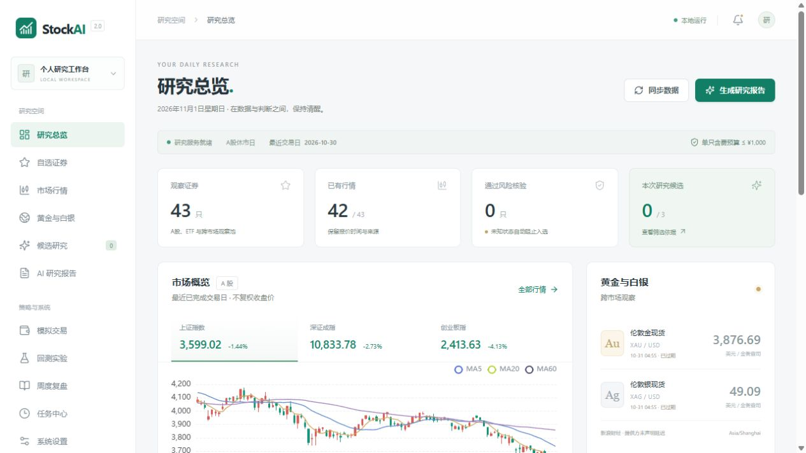
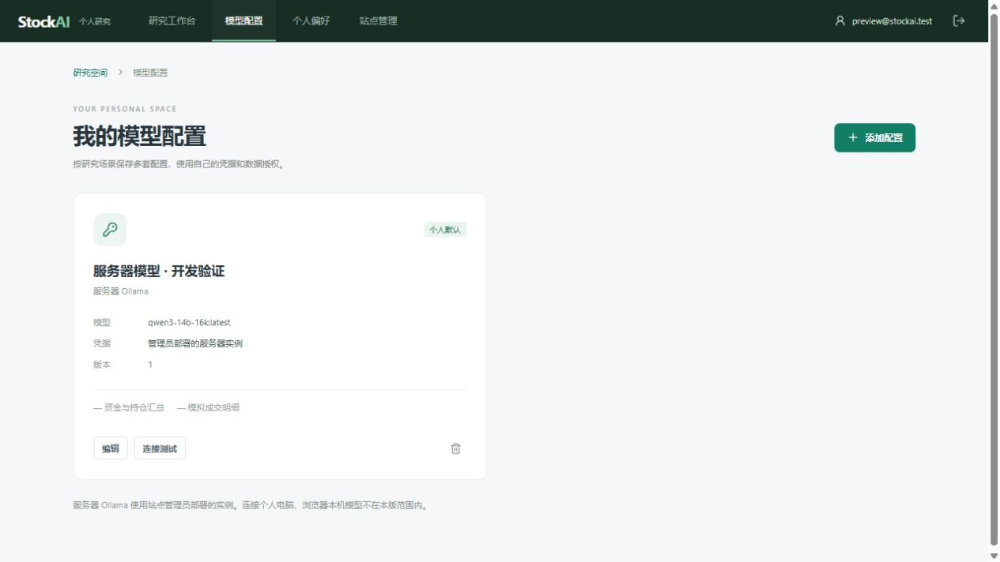

> 当前正式版：**3.2.2**，见 [下载发行包](https://github.com/EdgarLi-Xun/StockAI/releases/tag/v3.2.2) 和 [更新记录](CHANGELOG.md)。包含单文件桌面 EXE、本机 Web、独立 Hub/远程客户端、研究工作台、AI 助手、加密同步与受控升级。真实 NAS、跨机与生产签名更新源仍需目标环境验收。

# StockAI

股票与贵金属研究、AI 解释、模拟交易和历史回测工具。支持 Windows 桌面与浏览器共用一套本地数据，也提供可独立部署的公网多用户模式。

## Windows 单文件桌面版（3.2.2）

主交付为 **`StockAI-3.2.2-Windows.exe`**，可在 [本版 Release](https://github.com/EdgarLi-Xun/StockAI/releases/tag/v3.2.2) 下载。双击打开桌面窗口，菜单「打开 Web 版」连接同一份本机后台与数据；包含研究增强、项目助手、加密同步和受控升级。不需要另装 Python、Node.js 或部署 Linux。

首次创建本机账号后即可使用。关闭窗口驻留托盘，选择「退出 StockAI」停止本机服务。数据保存在 `%LOCALAPPDATA%\StockAI\workspace`，替换 EXE 不会重置资料。3.2 操作与验证见 [使用说明](docs/使用说明-同步与升级.md) 和 [验收记录](docs/验收记录-同步与升级.md)；[3.1 EXE 历史验收](docs/Windows-EXE验收记录.md) 保留。下文保留原源码 ZIP 与独立公网部署方式。

**所有交易均为模拟；项目没有真实证券账户接入或实盘下单接口。**

[下载当前正式版](https://github.com/EdgarLi-Xun/StockAI/releases/tag/v3.2.2) · [桌面版指南](docs/Windows-EXE使用说明.md) · [公网部署指南](deploy/cloud/README.md) · [更新记录](CHANGELOG.md)



## 可以做什么

- **行情观察**：自选股票、ETF、指数及黄金白银，展示行情来源、时间、币种、单位和数据缺口。
- **研究报告**：标准版早报、完整版复盘、定时归档；模型不可用时生成带原因的规则报告。
- **风险与预算检查**：检查证券状态、证据时效、交易单位、费用和预算；候选最多三只，也可以为零。
- **模拟交易**：虚拟资金、限价委托、现金与持仓预留、T+1、费用、滑点和交易流水。
- **历史回测**：收盘信号、后续开盘撮合、样本内外划分、费用敏感性，以及带 SHA256 的快照重演。
- **个人研究空间**：公网模式提供邀请注册、邮箱验证、个人自选/报告/模拟账户/回测、模型配置和任务队列。
- **研究工作台与 AI 助手**：数据就绪度、条件提醒、研究日志、组合风险和课题实验；全局助手与独立页面共用会话、草稿及资料引用。
- **任务中心与跨端同步**：集中查看任务、日志和安全重试；可选 HTTPS WebDAV 或独立 Hub 加密同步，管理设备、冲突与恢复点。
- **备份与恢复**：本地 ZIP 备份；公网模式提供加密备份、离线恢复、主密钥轮换和账号注销流程。

## 选择运行模式

| | 单文件桌面版 | 独立 Web 研究站点 | 独立同步 Hub |
| --- | --- | --- | --- |
| 适用场景 | 自己在电脑上研究，桌面与本机 Web 共用数据 | 在 Linux 服务器上供多个用户分别使用 | 为各研究端保存加密同步资料 |
| 入口 | `StockAI-3.2.2-Windows.exe` | `backend.public_app:app`，由 Caddy 提供 HTTPS | `backend.hub`，独立域名和数据卷 |
| 默认地址 | `http://127.0.0.1:8765`，占用时顺延 | 配置的 HTTPS 域名，容器内部端口 8766 | 配置的 HTTPS 域名，容器内部端口 8770 |
| 模型服务 | 个人模型配置，含本机 Ollama | MiniMax、OpenAI 兼容 HTTPS 服务、服务器端 Ollama | 不运行模型或研究任务 |
| 个人数据 | `%LOCALAPPDATA%\StockAI\workspace` | 独立研究数据卷，按用户隔离 | 密文业务对象和独立控制卷 |
| 操作说明 | [桌面指南](docs/Windows-EXE使用说明.md) | [部署与迁移](deploy/cloud/README.md) | [Hub 部署](deploy/hub/README.md) |

当前研究工作台、桌面 EXE、Web 和 Hub 版本为 **3.2.2**。原源码本地版仍保留 2.0.0 的入口与包元信息，数据目录与新桌面版独立。首次发布的 Windows 源码 ZIP 保留在 [v2.0.0 Release](https://github.com/EdgarLi-Xun/StockAI/releases/tag/v2.0.0)；下文的源码本地版安装步骤仅适用于该旧入口。两种模式不会自动迁移或混用数据。

## 原源码本地版：Windows ZIP

需要标准版 **Python 3.11 / 3.12 / 3.13**，安装时包含 Python Launcher（`py`）。请勿使用 free-threaded Python。桌面模式使用 PySide6 / Qt WebEngine。

1. 在 [v2.0.0 Release](https://github.com/EdgarLi-Xun/StockAI/releases/tag/v2.0.0) 下载 **`StockAI-2.0.0-Windows.zip`**，解压到可写目录。
2. 双击 **`Install-StockAI.cmd`**，等待依赖安装完成。首次安装需要联网，依赖安装在项目 `.venv/` 内。
3. 双击 **`Start-StockAI.cmd`** 打开桌面窗口，或双击 **`Start-Web.cmd`** 打开浏览器。
4. 在“系统设置”核对费用与模型配置，再点击“同步数据”。

发行 ZIP 已包含构建后的本地页面，**不需要安装 Node.js**。GitHub 自动生成的 “Source code” 压缩包不包含构建产物，需要按下节安装。

只运行浏览器版、避免安装桌面依赖：

```powershell
powershell -NoProfile -ExecutionPolicy Bypass -File scripts\install.ps1 -WebOnly
.\Start-Web.cmd
```

校验下载文件：

```powershell
Get-FileHash .\StockAI-2.0.0-Windows.zip -Algorithm SHA256
# 与 Release 中的 StockAI-2.0.0-Windows.zip.sha256 比较。
```

关闭桌面窗口后，共享后台服务会继续运行。停止服务：

```powershell
powershell -NoProfile -ExecutionPolicy Bypass -File scripts\stop.ps1
```

## 从源码运行与开发

需要 Git、上述 Python 版本，以及 **Node.js 22.12+**；本次发布在 Python 3.13 / Node.js 24 上验证。以下命令在 Windows PowerShell 中执行：

当前完整桌面工作台的源码入口为 `stockai_desktop.py`：安装 `requirements-desktop.txt` 和 `requirements-cloud.txt` 后执行 `npm --prefix frontend ci`、`npm --prefix frontend run build:public`，再运行 `python stockai_desktop.py`。下列 `run.py` 与启动脚本保留原源码本地版入口，操作见 [原本地指南](docs/LOCAL.md)。

```powershell
git clone https://github.com/EdgarLi-Xun/StockAI.git
cd StockAI
powershell -NoProfile -ExecutionPolicy Bypass -File scripts\install.ps1
.\Start-StockAI.cmd
```

源码不提交 `frontend/dist/`，安装脚本会执行 `npm ci` 并构建页面。只需 Web 版时，为安装命令添加 `-WebOnly`。

前后端分别开发：

```powershell
# 终端 1：后端，默认 127.0.0.1:8765
.\.venv\Scripts\python.exe run.py --serve

# 终端 2：前端，127.0.0.1:5173，/api 代理到 8765
npm --prefix frontend run dev
```

### 本地模型与首次研究

在本机运行 Ollama，使设置中的服务地址和模型名与实际安装一致。默认地址为 `http://127.0.0.1:11434`，默认模型名为 `qwen3-14b-16k:latest`；该名称需要本机已有对应模型，也可以在设置中改为自己安装的模型。

模型离线时仍可进行行情、风险与预算计算，并生成规则报告。价格、交易资格、预算、数量和来源由程序计算；模型只生成经过校验的定性解释。

首次同步后，在证券详情核查官方上市、停复牌、公告与交易规则证据，并在系统设置确认费率。**抓到行情不代表证券已通过风险核验**，证据未知、过期或费用后超预算的证券不会进入候选。具体操作与回测数据格式见 [本地指南](docs/LOCAL.md) 和 [历史数据导入](docs/HISTORICAL-DATA.md)。

## 部署公网多用户版

首发部署目标为 **Linux x86_64、单机、单个 Uvicorn worker、20 个账号、两个报告执行槽**。需要 Docker Compose、可用域名、SMTP 服务和由运维保管的 age 备份身份；从源码构建前端还需 Node.js 24。

本版 Release 中的 **`StockAI-3.2.2-Public.zip`** 包含公网源码、部署配置及预构建的公网页面，使用该包可以跳过下方 `npm ci` / `npm run build:public`，从 `deploy/cloud` 的环境配置开始。独立同步 Hub 使用同版的 **`StockAI-3.2.2-Hub.zip`**，部署步骤见 [Hub 指南](deploy/hub/README.md)。下载后用各包同名 `.zip.sha256` 核对完整性。

从源码根目录开始：

```sh
cd frontend
npm ci
npm run build:public
cd ../deploy/cloud
cp .env.example .env
# 编辑 .env：域名、固定 HTTPS 地址、SMTP 和 age 接收公钥。

docker compose build app
docker compose run --rm -it app python -m backend.cloud.cli init --email admin@example.com
docker compose up -d
```

管理员密码由终端交互输入。其他用户通过单次邀请码注册并验证邮箱。Caddy 对外提供 80/443，应用端口、SQLite 和 Ollama 保持内部访问；正式环境不启用 `STOCKAI_CLOUD_DEV=1`。

用户可保存多套个人模型配置并选择默认项；API Key 加密保存，资金持仓汇总和逐笔模拟成交授权默认关闭。连接测试与实际 AI 任务可能消耗模型服务额度。新账号的自动计划和自动 AI 默认关闭。



部署前请阅读完整的 [公网部署、迁移与恢复指南](deploy/cloud/README.md)，尤其是研究数据、注销权威记录、凭据主密钥三个独立目录的保管方式，以及 [公网验证范围](docs/验收记录-公网多用户与模型接入.md)。本次发布不等于已在你的域名或服务器上线。

本机隔离预览（仅开发用途）：

```powershell
.\.venv\Scripts\python.exe -m pip install -r requirements-cloud.txt
npm --prefix frontend run build:public
.\.venv\Scripts\python.exe scripts\preview-cloud.py
```

打开 `http://127.0.0.1:8766`；自动生成的预览登录信息保存在 `.tmp/cloud-preview/preview-login.txt`，预览不会读取或迁移本地 `data/`。公网前端在开发模式下如需热更新，应自行将 Vite 的 API 代理改为 8766；默认开发命令连接本地版。

## 测试与打包

在完成源码安装后执行。开发依赖包含本地与公网模块的测试所需依赖：

```powershell
.\.venv\Scripts\python.exe -m pip install -r requirements-dev.txt
.\.venv\Scripts\python.exe -m pytest
node --test tests/frontend-*.test.mjs
npm --prefix frontend run build
npm --prefix frontend run build:public
.\.venv\Scripts\python.exe scripts\package-exe.py --skip-build
.\.venv\Scripts\python.exe scripts\package-cloud.py
.\.venv\Scripts\python.exe scripts\package-hub.py
```

EXE 构建需按 `requirements-exe.txt` 准备 Windows 构建环境与已校验的 age 工具，详见 [桌面版构建说明](docs/Windows-EXE使用说明.md)。三种发行包与各自 SHA256 文件输出到 `dist/`；EXE 另附构建元数据，Public / Hub ZIP 包含逐文件哈希清单。原源码本地版 ZIP 仍可用 `scripts/package.ps1` 构建。发行包不包含本机数据库、报告归档、凭据、虚拟环境或依赖缓存。

真实 age 加密往返测试需要额外提供 age / age-keygen；缺少工具时会明确跳过对应测试。测试使用隔离数据，不需要真实模型 Key，也不会以自动化测试结果冒充真实 SMTP、域名 TLS 或跨机器安装验收。验证记录见 [本地版验收](docs/ACCEPTANCE.md)、[公网版验收](docs/验收记录-公网多用户与模型接入.md) 和 [首发验证](docs/RELEASE-2.0.0.md)。

开发流程另在隔离 Linux 容器中验证了 46 项公网专项，以及 20 用户 / 两个执行槽的受控任务处理，详见 [Linux 补充验证](docs/CLOUD-LINUX-VALIDATION.md)。

## 数据与使用边界

- 行情主要通过 AKShare 接入免费数据源；接口可能限流、延迟、停用或无法覆盖部分代码。页面展示数据来源、采集时间与缺口，项目不保证实时行情。
- 上市、公告、交易规则与税费需要按具体产品核验。默认费率属于模拟假设，ETF 与股票费用分开处理。
- 免费历史日线通常缺少逐日风险状态、涨跌停和公司行动证据。严格回测在证据不足时拒绝验证；非严格模式保留“未验证实验”标识。
- 固定自选池有幸存者偏差；历史回测和 AI 解释不代表未来收益，不构成投资建议。
- 本地服务默认只监听回环地址。局域网访问需显式开启并配置密码与允许网段，参阅 [LAN / 反向代理](docs/LAN.md)。

## 项目结构与文档

```text
backend/          FastAPI、本地采集/研究/模拟交易/回测
  cloud/          公网身份、个人空间、模型配置、队列与加密备份
frontend/         Vue 3 + TypeScript + Vite + ECharts
desktop/          PySide6 / Qt WebEngine 桌面壳
config/           提示模板与示例配置
deploy/cloud/     Docker Compose、Caddy 与公网运维说明
scripts/          安装、启动管理、备份、预览与发行打包
tests/            本地与公网隔离回归测试
docs/             使用指南、需求、架构决策与验收记录
```

| 文档 | 内容 |
| --- | --- |
| [本地版完整指南](docs/LOCAL.md) | 研究流程、模拟交易、回测、调度、备份、升级与卸载 |
| [公网部署指南](deploy/cloud/README.md) | 初始化、迁移、模型配置、备份恢复与注销 |
| [历史数据格式](docs/HISTORICAL-DATA.md) | 导入字段、规则与证据格式 |
| [局域网与代理](docs/LAN.md) | LAN 设置和内网 HTTPS 代理示例 |
| [公网产品需求](docs/PRD-公网多用户与模型接入.md) | 账号与个人模型接入范围 |
| [研究增强与 AI 助手完整需求](docs/PRD-研究工作台与AI助手-完整需求.md) | 新增需求统一入口：流程、默认值、计算、异常、恢复和 78 个验收编号 |
| [研究增强与 AI 助手验收清单](docs/验收清单-研究工作台与AI助手.md) | 65 项受控通过、13 项真实服务或目标环境待联调 |
| [研究工作台增强需求](docs/PRD-研究工作台增强.md) | 本轮七项增强的范围、优先级与验收标准 |
| [项目内 AI 对话需求](docs/PRD-项目内AI对话.md) | 右下角悬浮助手、独立对话页、报告追问及授权范围；双入口已实现，目标手机待验 |
| [AI 助手双入口验收](docs/验收清单-AI助手双入口.md) | 7 项通过、1 项目标手机验收阻塞；共用会话和任务、手机适配及身份隔离 |
| [同步与独立部署需求](docs/PRD-同步与独立部署.md) | 自建 Hub / WebDAV、桌面与 Web 分开部署；已交付预览实现，目标环境验收见配套清单 |
| [同步与独立部署验收清单](docs/验收清单-同步与独立部署.md) | 19 项受控通过、13 项阻塞，保留实际 NAS、跨机等目标环境待验条件 |
| [版本升级与回滚需求](docs/PRD-版本升级与回滚.md) | 桌面/Web/Hub 版本检查、可信包验证、迁移与失败恢复；已交付预览实现，目标环境仍待验 |
| [版本升级与回滚验收清单](docs/验收清单-版本升级与回滚.md) | 21 项受控通过、11 项阻塞，区分升级前失败和新数据写入后的回退 |
| [架构决策](docs/adr/) | 模型所有权、多用户边界、管理权限和恢复策略 |
| [版本更新记录](CHANGELOG.md) | v2.0.0 及当前预览版的功能范围与版本说明 |

遇到问题时，请附上运行模式、操作系统、Python / Node.js 版本、复现步骤和脱敏日志，到 [Issues](https://github.com/EdgarLi-Xun/StockAI/issues) 反馈。请勿上传数据库、API Key、邮件密码或备份私钥。

## 研究工作台与项目助手（本轮新增）

公网 Web 入口新增就绪度、用量上限、条件提醒、版本化研究日志、组合风险、课题实验及项目助手/报告追问。开发预览使用独立的 `http://127.0.0.1:8766`；原本地版 `8765` 保持独立。

操作与恢复控制状态保护见 [使用说明](docs/使用说明-研究工作台与AI助手.md)，执行结果和真实服务待验事项见 [本轮验收记录](docs/验收记录-研究工作台与AI助手.md) 及 [78项登记](docs/验收清单-研究工作台与AI助手.md)。

2026-11-02 的历史交付为 `3.1.0-preview.1`，包名 `dist/StockAI-3.1.0-preview.1-Public.zip`；研究数据增量升级到 schema 2。当天续开发补齐修订历史、稳定重试、提醒续期、组合分段与助手资料校验，完整回归及 20 用户测量的脱敏证据随文档分发。
