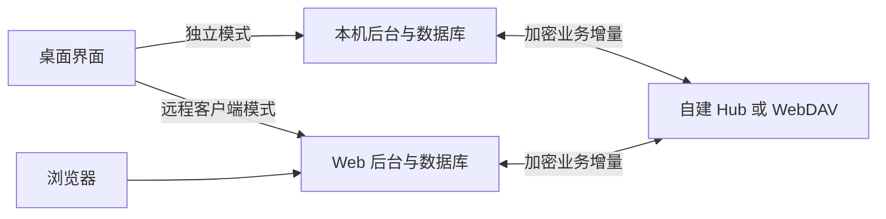

# StockAI 新增需求：Hub / WebDAV 同步与桌面、Web 独立部署

| 项目 | 内容 |
| --- | --- |
| 文档版本 | 1.1 |
| 确认日期 | 2026-11-02（Asia/Shanghai） |
| 需求来源 | 用户要求支持 Hub 或 WebDAV 同步，桌面和 Web 分开部署；Hub 已确认为自建 StockAI 同步中心 |
| 当前状态 | 新增需求，待实现和验收；本次仅编写需求 |
| 承接范围 | 已有本地桌面、独立 Web、多用户研究工作台与项目助手 |

本文新增同步及分开部署能力，承接 [研究工作台与 AI 助手完整需求](PRD-研究工作台与AI助手-完整需求.md)。此前“桌面同步改造另行安排”的范围，本次按本文明确纳入；既有研究功能的执行结论以 [验收记录](验收记录-研究工作台与AI助手.md) 为准。新增 32 项 SYNC-AC 验收单独登记，不修改原 78 项的执行结果。

同日新增 [版本升级与回滚需求](PRD-版本升级与回滚.md)：桌面、Web、Hub 各自受控升级，维护期间保留同步进度和控制状态，升级顺序按协议兼容矩阵确定。升级另设 32 项 UPG-AC，不替换本文件同步验收。

## 1. 目标与运行方式

用户可以只安装桌面版、只部署 Web 版，也可以分别部署两端后同步个人研究空间。未配置同步服务时，两端仍可各自使用。

| 运行方式 | 部署与数据归属 | 必须支持的行为 |
| --- | --- | --- |
| 桌面独立模式 | Windows 客户端、本机业务后台和本机数据库 | 不依赖公网 Web 或 Hub；本地保存研究资料，可选连接本人配置的模型与同步服务 |
| Web 独立模式 | Linux Web 服务、服务端数据库，浏览器访问 | 不依赖任何桌面实例；后台采集、研究、备份和同步不因浏览器关闭而停止 |
| 桌面连接远程 Web | 桌面作为远程服务客户端，数据写入所选 Web 后端 | 配置 HTTPS 服务地址并登录，使用该服务的账号与数据；不强制启动本机业务后台 |
| 两端独立并同步 | 桌面与 Web 各有后台、数据库和本地副本 | 通过同一 Hub 或 WebDAV 同步空间交换业务记录，支持离线编辑及重连处理 |

远程客户端模式使用 Web 端实时数据，不再额外复制同一份本地业务库。切换运行模式、站点或账号时明确显示目标，隔离缓存、会话和本地空间，不能把本地管理员权限带到远程服务。

Hub 可与 Web 服务同机部署，也可独立部署在另一台服务器。两者需要独立配置、数据目录、启动和升级入口；关闭桌面不会停止远程 Web 或 Hub，停止 Hub 不应使独立桌面/Web 的本地研究失效。

## 2. 同步空间与身份

- 同步单位是“本人的个人研究空间”，拥有稳定的空间 ID；每个参与端有独立设备 ID、名称和同步进度，Web 后台也视为一个参与端。
- 本地身份、Web 登录身份和同步空间身份显式绑定。加入已有空间需验证本人身份及解密能力，不能仅凭相同邮箱、用户名或模拟账户名自动合并。
- 一个个人空间同一时刻选择一个主同步后端：Hub 或 WebDAV。两种方式必须分别可用，不要求购买或部署另一种后端；不得在失败后自动切换到另一套存储。
- 切换后端先暂停旧端写入、核对待同步记录及删除状态，再预览并迁移到目标空间；保留本地恢复点。绑定失败不覆盖本地资料或重新初始化远端。
- Web 多用户同步按用户分别绑定，只能同步本人的对象；管理员的站点备份和共享市场管理权限不变，不能通过同步接口下载他人的私人研究。

## 3. 同步内容与边界

| 内容 | 默认同步方式 | 约束 |
| --- | --- | --- |
| 自选、分组、置顶与个人研究参数 | 同步业务记录和版本 | 参数变更仅作用于新计算，不改旧任务快照 |
| 报告、候选与原始事实快照 | 同步不可变版本及关联文件 | 保留来源、时间、计算与模型说明；相同内容按哈希去重 |
| 研究日记、修订和观察结果 | 同步版本、关联及计算记录 | 并发修订保留分支，个人备注不因同步而获得云模型外发授权 |
| 模拟账户、订单、成交、持仓与账本 | 按账户受控同步完整一致状态 | 单一写入端与账本校验，不能直接相加现金或拼接持仓 |
| 实验课题、参数、结果与复现快照 | 同步独立实验和依赖资料 | 接收实验不自动重新运行；不能用当前行情替换旧数据 |
| 对话历史及其引用 | 同步已保存的完整/中断状态 | 接收历史不继续生成；重发前执行当前端模型授权和来源检查 |
| 提醒规则、执行归属和触发记录 | 同步规则、版本和已执行标识 | 只有指定执行端触发和投递，不能在每个端重复通知 |
| 删除标记、设备进度与用量控制记录 | 作为同步控制状态同步 | 防止已删数据回生、请求重发及额度返还 |
| 模型配置名称、服务类型及模型标识 | 可同步不含秘密的配置描述 | 新端显示未连接，地址可用性重新检查，授权和 Key 不自动继承 |
| 通用行情缓存、运行日志和安装环境 | 默认各端自行维护 | 已被报告/回测归档引用的事实快照必须随依赖传输 |
| Key、密码、Cookie、会话、SMTP/WebDAV 凭据及站点主密钥 | 不进入普通同步包 | 由各端分别安全配置；不导出到日志、模型输入或同步正文 |

不直接同步正在使用的 SQLite、WAL、journal 或整个运行目录。同步以业务记录、不可变附件和变更日志为单位，接收后经过校验再事务应用；SQLite 文件及其日志的一致性不能由文件夹同步替代。[SQLite 数据库损坏说明](https://sqlite.org/howtocorrupt.html)

## 4. 自建 Hub 要求

- 提供可独立安装、配置、启动、升级和备份的同步服务，支持 HTTPS、账号验证、个人空间、设备绑定与撤销、增量上传下载、对象校验及同步状态查询。
- 绑定新设备使用有时效、单次使用的授权，不能只输入空间 ID 就访问数据。设备凭据可单独撤销；账号停用阻止新的同步请求。
- 服务端按用户和空间检查访问权限，支持按已确认游标分页拉取、重复上传去重和版本前提检查；提交成功返回可持久化确认，不能把仅收到请求当作同步完成。
- 保存设备确认进度、删除标记和空间版本，支持诊断待同步、冲突、拒绝和中断状态；管理页面不提供他人私有研究正文入口。
- Hub 可提供自动任务归属及共享调用额度的原子协调。部署成独立服务时不依赖桌面在线，也不强制包含行情采集或模型推理服务。

## 5. WebDAV 要求

- 可填写服务器地址、账号、应用密码或访问凭据及专用目录，支持连接、权限、剩余可用空间能力及读写一致性测试；服务不提供容量接口时显示未知，不能捏造剩余空间。
- 每个同步空间使用独立命名目录和加密清单。连接测试只操作本应用的临时测试对象，不能删除或改写用户已有文件。
- 验证目录查询/创建、对象读取/写入及条件更新等实际能力，不以 HTTP 连接成功等同于可双向同步。目录与资源操作遵循 WebDAV 协议。[RFC 4918](https://www.rfc-editor.org/rfc/rfc4918)
- 对清单、执行归属与用量控制记录采用强 ETag 和条件更新，或经验证具备同等原子性的方法。前提失败时重新读取并合并，不能覆盖竞争端的新版本；`If-Match` 和前提失败语义按 HTTP 标准处理。[RFC 9110](https://www.rfc-editor.org/rfc/rfc9110#section-13.1.1)
- LOCK 能力可选，不能假定所有服务都有。无法证明条件写和一致性安全时明确不兼容并停止双向写入，可保留只读拉取；不得降级为无保护覆盖。
- 桌面由本机后台连接 WebDAV，Web 模式由该用户的服务端同步模块连接。浏览器不直接持有 WebDAV 密码，不因跨域限制而要求用户暴露第三方凭据或开放任意跨域。
- 默认 HTTPS，支持配置可信证书。连接内网 NAS 需在实际发起请求的端显式允许目标地址；服务器端还需管理员配置允许的内网范围。限制重定向和 DNS 解析后的目标，不能借自定义 URL 读取服务器内部管理、云元数据或非同步服务。

## 6. 初次与日常同步

### 6.1 初次同步

1. 选择本地模式、个人空间和同步后端，验证连接及解密能力。
2. 显示本地、远端对象数量、版本、依赖、删除标记和冲突预览。
3. 本地非空且远端非空时默认合并预览，不以较新文件时间直接覆盖；明确选择后才提交。
4. 建立本地恢复点，先同步不可变依赖，再提交可引用它们的业务版本；依赖不完整的结果保持待完成，不发布为有效记录。
5. 验证条数、归属、哈希和关联，保存双方确认进度，显示完成或剩余冲突。

远端空目录、404、鉴权失败和暂时不可读分别处理，不能把它们都当作用户主动清空资料。新设备加入先取得当前完整快照及删除状态，再提交其本地待合并内容。

### 6.2 日常行为

- 默认未配置同步时关闭自动同步；配置完成后本人可开启。在线本地变更合并等待 5 秒后提交，活动同步端每 60 秒检查远端，支持手动立即同步、暂停和恢复。
- 离线可查看已有资料、维护自选和日记、运行有足够本地数据的确定性研究或回测；缺失资料仍按既有规则阻断。待同步记录持久保存，重启不丢失。
- 重连从最后确认进度继续，先读取最新删除和控制状态，再进行双向合并。相同操作重复传输不重复新增报告、消息或交易。
- 网络故障采用有上限退避，显示下一次重试；鉴权、解密、协议不兼容及存储满等待处理，不能无限快速重试。传输中断不丢弃唯一的本地副本。
- 桌面退出时明确显示后台同步是否继续，提供停止本机后台入口；不停止远程服务。Web 同步由服务端运行，不依赖浏览器页面一直打开。
- 同步暂停、解绑、删除远端资料分开操作。解绑默认保留本地数据，也不删除远端；重置本地或删除远端需要明确对象和后果确认。

## 7. 版本、冲突和删除

- 每个对象有全局记录 ID、所属空间、来源设备、业务/schema 版本、父版本、内容哈希、操作 ID 和删除状态。以因果版本及服务端确认判断新旧，不依赖设备墙钟先后。
- 不同对象可以自动合并；同一对象不同字段只有在能证明互不覆盖时合并。自选分组、研究参数、日记文本等同字段冲突进入冲突中心，保留双方内容与共同基线。
- 冲突中心支持保留本地、保留远端或手动合并，并形成新的解决版本。其他无冲突记录继续同步，不能静默丢弃一方内容。
- 不可变报告、消息或快照出现同 ID 不同哈希时隔离并报错，不以“最新”覆盖。消息顺序及实验关系保持一致，重复接收不创建新调用或新实验。
- 删除使用可传播的墓碑；旧设备的普通修改不能自动复活已删记录。用户明确恢复时创建可追踪的新版本，不伪装为从未删除。
- 墓碑至少保留 30 天且所有活跃设备确认后才可清理；长期离线或已撤销设备重新加入时要求当前完整状态校准，旧修改先预览，不直接回放。
- 发现远端回滚、同步链不连续、未知 schema 或缺少可信删除状态时暂停受影响的写入，提示恢复或升级；不能将旧备份作为新版本覆盖控制记录。

## 8. 模拟账本、自动任务与 AI 调用

### 8.1 模拟账户单一写入

同一模拟账户同一代次只允许一个写入端。其他端可以查看已同步结果；切换写入端需在线完成账本核对并取得新的写入代次，离线不能抢占。独立端仍可创建自己的新模拟账户。

离线写入只允许在已授权的账户分支中进行。重连发现写入代次已过期或双方产生账本分支时，冻结该账户的继续交易，保留分支并提示处理；不能相加现金、重复成交或覆盖权威账本。需要保留分支时通过受控方式建立独立模拟账户，不把冲突数据并入同一余额。

订单、成交、持仓、现金和费用作为一致业务单元校验。收到待成交订单只显示其状态，不在接收端自动再撮合；收到成交不再次扣款或收取费用。

### 8.2 自动任务单一执行

同一同步空间为自动报告、提醒和通知指定执行端并维护可核验的归属代次或租约。每次自动执行前核验，无法确认时暂停，其他端只同步结果。切换执行端先处理在途状态，不将历史任务当作新任务补跑。

逻辑任务键、模型调用 ID 和通知事件 ID 跨端稳定，避免两端同时生成付费报告、重复投递提醒或重演不确定调用。手动发起新任务仍是明确的新请求，不把数据同步当作执行授权。

### 8.3 跨端调用限制

同步空间的日/月上限按本人跨端合计，报告、对话、测试、重试和额外模型摘要均纳入。Hub 用原子服务协调，WebDAV 用经验证的条件更新维护共享预留与发送记录；不能将每台设备独立获得的完整额度相加。

启用有限上限时，所有模型请求（含 Ollama）在发送前取得在线共享额度预留；离线或无法核对最新控制状态时暂停新的 AI 请求，仍可使用规则功能。未设置上限时可按本机配置使用模型，记录待同步调用事实，不能把它标成另一端已确认的实时总量。

同步来的自动 AI 开关、旧 Key 引用和其他端的数据授权不自动生效。新端需本人完成模型连接和授权；对话历史重发按当前端有效授权重新投影，不能借同步绕过已撤销权限。

## 9. 加密、设备与恢复

- 传输使用 TLS，业务同步包和附件在进入 Hub/WebDAV 前加密并进行完整性认证。同步密钥与登录密码、WebDAV 密码分开管理，提供恢复材料导出及妥善保管说明。
- 凭据由参与端的安全存储保存；Web 后端作为授权参与端需安全保管其解密材料。Hub/WebDAV 存储密文和必要协议元数据，不将同机部署描述为运维者绝对无法接触端点明文。
- 输入错误密钥、对象损坏、伪造目录路径、异常大对象或解压越界时拒绝导入，保留当前有效本地数据，不通过清空空间“修复”。
- 支持撤销设备和同步凭据、轮换同步密钥。撤销阻止后续联机访问，不能撤回已下载到离线端的数据；离线端恢复联机时先校验撤销状态。
- 账号注销或删除同步空间需发布最新删除状态并清理在线副本。网络不可达时显示远端删除待完成，不把本机删除冒充所有远端已清理。
- 同步不是历史备份。既有加密备份保留规则继续适用；恢复后先核对最新墓碑、设备代次、模型用量和通知未决状态，防止回生、重复执行及额度返还。
- 协议与业务版本不兼容时提供升级或只读提示，不能让旧客户端覆盖新字段。升级和后端迁移需提供回滚点，不复用另一站点的密钥或空间身份。

## 10. 页面与交付

新增“运行模式与同步”设置：显示当前模式、站点、空间、设备、后端、最近成功时间、待上传/下载、冲突数量和执行归属。提供测试连接、首次预览、立即同步、暂停、重连、冲突处理、设备管理及解绑入口；凭据仅可替换，不回显完整值。

状态至少区分未配置、连接中、同步中、已同步、有待处理冲突、离线待同步、鉴权失效、不兼容、存储不足和被暂停。失败要说明影响及下一步，不能只显示一个永久旋转图标；同步失败不阻断其他已具备资料的本地研究。

分别提供桌面安装/升级入口、Web 部署包和 Hub 部署包或可独立启用的服务角色，说明端口、健康检查、数据目录、证书、版本兼容、备份恢复和卸载行为。Web 主机无需安装 Qt，纯远程桌面入口无需启动本地采集与调度；两端不共用网络文件系统上的 SQLite。

## 11. 计划验收标准

以下 32 项均待执行，单独登记在 [同步与独立部署验收清单](验收清单-同步与独立部署.md)，不沿用既有研究工作台的通过结论。

| 编号 | 场景 | 预期结果 |
| --- | --- | --- |
| SYNC-AC-01 | 仅安装桌面，无 Web/Hub | 可启动本机研究并持久保存，不强制访问远程站点 |
| SYNC-AC-02 | 仅部署 Web，无桌面和 Qt | 可登录和研究；关闭浏览器后已启用的后台服务继续运行 |
| SYNC-AC-03 | 桌面连接远程 Web | 使用所选远程账号和数据，不启动本机业务后台 |
| SYNC-AC-04 | 切换本地/远程、站点或账号 | 模式标识准确，会话与缓存隔离，无本地管理员旁路或数据串用 |
| SYNC-AC-05 | 桌面/Web/Hub 同机或分机启动停止 | 各角色可独立配置和升级，关闭一端不停止另一独立服务 |
| SYNC-AC-06 | 两端空白或一端已有数据首次绑定 | 先验证身份及解密能力，再预览和导入，空间和归属正确 |
| SYNC-AC-07 | 同邮箱的独立账号或构造他人空间 ID | 不自动合并、不越权访问；Hub 和 WebDAV 目录隔离有效 |
| SYNC-AC-08 | Hub 绑定新设备、撤销及账号停用 | 授权有时效且单次使用，撤销后不能继续联机同步 |
| SYNC-AC-09 | Hub 分页增量、重复提交、传输后确认丢失 | 从持久进度恢复，同一操作只应用一次 |
| SYNC-AC-10 | WebDAV 正常能力和临时测试对象 | 查询、创建、读写及一致性测试可完成，不改用户已有文件 |
| SYNC-AC-11 | WebDAV 并发更新、条件失败或缺少安全写能力 | 重读合并或明确停写，不覆盖竞争端新版，不假设存在 LOCK |
| SYNC-AC-12 | WebDAV 401/403、空间满、NAS 证书或地址不受信 | 显示对应原因；不泄露凭据、不绕过信任策略、不无限重试 |
| SYNC-AC-13 | 同步各类个人资料及原始附件 | 版本、来源、时间、引用和哈希完整；缺依赖不发布为有效结果 |
| SYNC-AC-14 | 检查同步包、浏览器和日志 | 不含 Key、密码、会话和站点主密钥；业务包以密文存储 |
| SYNC-AC-15 | 同步报告/实验/对话/待成交订单 | 只接收业务状态，不重新推理、重跑实验或重复撮合 |
| SYNC-AC-16 | 离线编辑、应用重启后重连 | 待同步变更不丢，先读删除与控制状态，再按确认进度补传 |
| SYNC-AC-17 | 远端空目录、404、暂时不可读或备份回滚 | 不把异常当清空指令，保留本地数据并要求恢复或重建确认 |
| SYNC-AC-18 | 同字段并发编辑、设备时间漂移 | 基于父版本识别冲突，保留双方，时间较新不直接胜出 |
| SYNC-AC-19 | 解决冲突或遇同 ID 不同内容哈希 | 解决生成新版本；不可变对象冲突隔离，不覆盖旧内容 |
| SYNC-AC-20 | 删除后旧设备回传、墓碑清理和长期离线端回归 | 删除不回生；满足保留及确认条件才清理，旧端先完整校准 |
| SYNC-AC-21 | 同一模拟账户两端操作、写入端切换 | 一个有效写入代次，其他端只读；离线不能抢占 |
| SYNC-AC-22 | 离线账本分叉、重复成交、部分批次失败 | 冻结冲突分支并校验现金/持仓，不相加余额、不重复记费，事务不留半套账 |
| SYNC-AC-23 | 两端均配置自动报告与提醒 | 仅指定执行端运行，稳定任务和事件 ID 防止重复调用/通知 |
| SYNC-AC-24 | 执行端租约失效、切换或结果不明 | 暂停未发动作，不重演不明调用或历史任务，不伪造已完成 |
| SYNC-AC-25 | 跨端剩余一次日/月额度、Hub/WebDAV 竞争 | 最多一次发送；旧备份、换设备和重复提交不能恢复额度 |
| SYNC-AC-26 | 有限额度时断网、未设额度时本机调用 | 前者暂停新 AI 但规则可用；后者记录未同步用量，不宣称全局已确认 |
| SYNC-AC-27 | 新端接收模型描述、授权撤销后追问旧对话 | 配置标记未连接，Key/授权不继承；历史和摘要不绕过当前权限 |
| SYNC-AC-28 | 换后端、暂停、解绑或删除同步空间 | 操作语义区分，有预览与恢复点；解绑不隐式删数据，远端删除未完成可见 |
| SYNC-AC-29 | 错误密钥、密文损坏、恶意路径及缺依赖 | 拒绝无效导入，当前本地有效数据不被清空或替换 |
| SYNC-AC-30 | 账号注销、密钥轮换及旧备份恢复 | 最新删除/代次/用量生效，旧记录不回生，未决任务不重发 |
| SYNC-AC-31 | 协议/schema 不兼容、升级失败及角色安装 | 阻止不兼容覆盖，可回滚；桌面/Web/Hub 各有清晰部署与数据目录说明 |
| SYNC-AC-32 | 大批初次同步、局部更新、断点恢复与页面状态 | 记录传输量、耗时和重试；增量不全库重传，状态与实际一致，失败不阻断独立研究 |

## 12. 完成定义

Hub 和 WebDAV 两种后端均需验证，独立桌面、独立 Web 和远程桌面模式分别完成安装与隔离测试；冲突、删除、模拟账本、自动任务、跨端额度、密钥和恢复专项通过后才可标为完成。实际 NAS/WebDAV 服务、HTTPS、跨机器断网恢复和目标服务器联调单独记录，不能以接口替身或文档检查替代。

本次交付先形成需求及验收计划。同步协议、表结构和安装参数在实施设计中落实，不能通过整库文件覆盖、传输凭据、静默覆盖冲突或放弃跨端调用限制简化既定行为。

## 13. 升级衔接

升级期间暂停受影响端的同步应用和执行租约，保留待发记录、墓碑、用量和不确定调用状态。协议不兼容的旧端停止写入并提示升级，不丢弃其离线资料；回滚也不能复活删除记录或返还已经消耗的额度。具体安装、迁移和恢复行为按升级 PRD 执行，第三方 WebDAV/NAS 本身不由 StockAI 升级。
