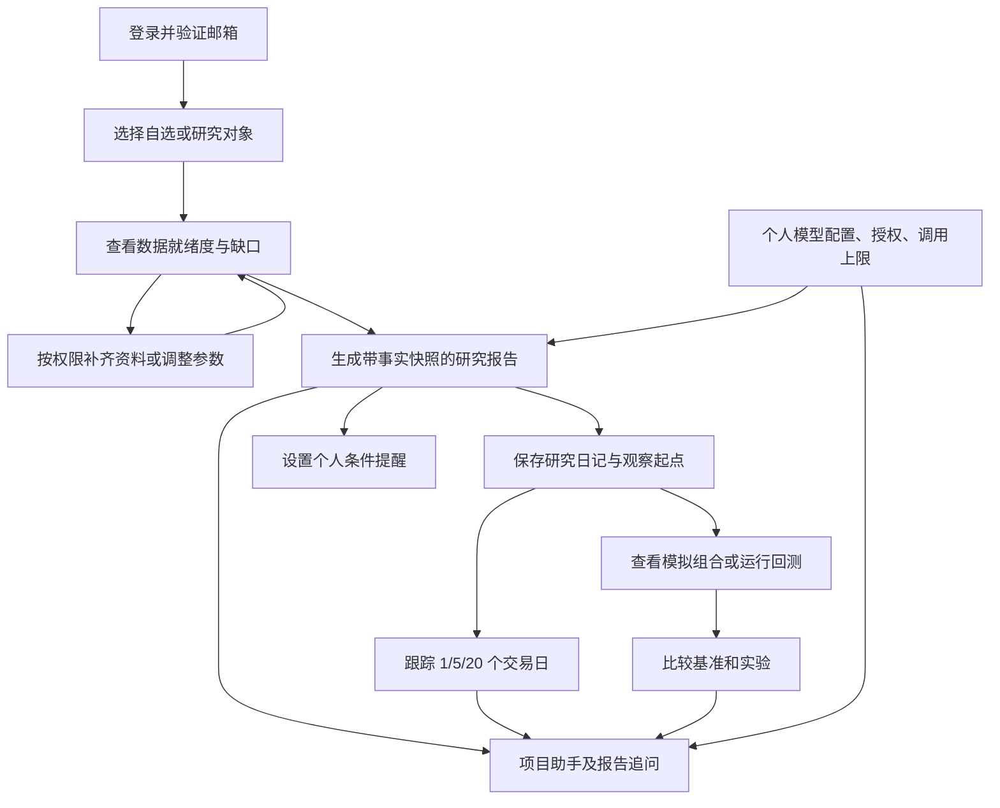
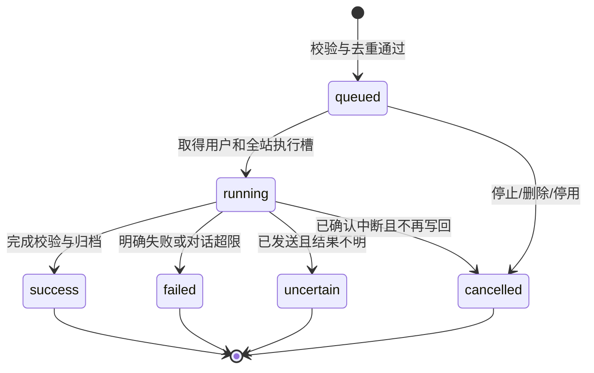

# StockAI 研究工作台与 AI 助手：完整补充需求

| 项目 | 内容 |
| --- | --- |
| 文档版本 | 1.3 |
| 更新日期 | 2026-11-02（Asia/Shanghai） |
| 需求依据 | 用户要求增加项目内 AI 对话、确认七项增强全部纳入，并要求补充完整 |
| 产品状态 | 研究增强与助手已有受控验收记录；助手双入口、同步、独立部署及版本升级新增要求待实现/验收 |
| 交付范围 | 七项研究增强及助手、桌面/Web 独立部署、Hub/WebDAV 同步和桌面/Web/Hub 升级回滚 |
| 规模基线 | 20 个账号；报告、对话和连接测试共享全站两个模型执行槽 |

本文作为需求的统一阅读入口，补齐模块文档中的流程、默认值、计算口径、状态和交付标准。[研究工作台增强](PRD-研究工作台增强.md) 保留 ENH-01 至 ENH-07 及 28 项模块验收；[项目内 AI 对话](PRD-项目内AI对话.md) 保留 18 项对话验收；本文保留 COMP-AC-01 至 COMP-AC-32。三组共 78 个验收编号的实际结论以执行记录为准，不由需求文字推定。

研究功能执行登记见 [78 项验收清单](验收清单-研究工作台与AI助手.md) 和 [验收记录](验收记录-研究工作台与AI助手.md)。2026-11-02 新增的同步及分开部署见 [独立需求](PRD-同步与独立部署.md) 和 [32 项待执行清单](验收清单-同步与独立部署.md)，不修改既有执行结论。

同日新增 [版本升级与回滚需求](PRD-版本升级与回滚.md)，覆盖版本检查、可信包验证、备份迁移、维护切换和安全回退；对应 [32 项升级验收](验收清单-版本升级与回滚.md) 单独待执行，不表示现有安装包已有在线升级器。

同日明确 AI 助手必须同时提供右下角悬浮入口和独立页面，详见 [助手 PRD 第 1 节](PRD-项目内AI对话.md)。新增 [8 项双入口验收](验收清单-AI助手双入口.md) 单独待执行，不修改原 78 项执行结论。

既有账号、共享行情、个人研究空间、模拟交易、回测和运维要求继续遵守 [公网产品需求](PRD-公网多用户与模型接入.md)。本文对本次新增功能的具体口径作补充；已确认的七项与项目范围限制不减少。以下新增默认值是为消除实现歧义而确定的产品默认，不代表用户曾逐项指定，也不代表供应商能力或已实测结果。

## 1. 产品目标与范围

用户应能完成“知道数据是否够用 → 形成研究判断 → 跟踪变化 → 复盘验证 → 在项目内追问”的完整过程。AI 解释程序提供的事实，预算、候选资格、收益、回撤和提醒触发继续由程序计算。

| 编号 | 优先级 | 必须交付的能力 | 主要用户结果 |
| --- | --- | --- | --- |
| ENH-01 | 高 | 数据就绪度面板 | 知道哪些资料缺失、为何没有候选、下一步如何处理 |
| ENH-02 | 高 | 个人模型用量与调用上限 | 看清站内用量，并控制自己的日/月请求次数 |
| ENH-03 | 高 | 个人条件提醒 | 在数据更新后获知价格、风险或候选状态变化 |
| ENH-04 | 中 | 研究日记与结论跟踪 | 保留当时判断，查看随后 1/5/20 个交易日表现 |
| ENH-05 | 中 | 模拟组合整体风险 | 理解账户整体仓位、集中度和回撤及其数据缺口 |
| ENH-06 | 中 | 回测基准与实验比较 | 在一致口径下比较策略、基准和参数实验 |
| ENH-07 | 中 | 基于报告追问 | 根据指定报告的原始证据解释原因与版本变化 |
| CHAT | 已纳入 | 项目内 AI 助手 | 连续询问 StockAI 使用、排错和本人研究内容 |

高、中仅决定内部顺序，全部属于交付范围。2026-11-02 已将 Windows 桌面独立运行、桌面连接远程 Web、Web 独立部署及两端经 Hub/WebDAV 同步纳入补充范围，详见第 13 节。首版助手提供只读解释和功能导航；任意网页搜索、文件上传、其他项目问答、实盘接入和对话内执行数据修改不纳入本次范围。

## 2. 用户与权限

| 身份 | 可使用能力 | 权限约束 |
| --- | --- | --- |
| 未登录或邮箱未验证 | 登录、邀请注册、邮箱验证和密码找回 | 不能访问私有增强数据或调用个人模型 |
| 普通已验证用户 | 本人数据就绪度、用量、提醒、日记、组合、实验和对话 | 列表、详情、引用、修改、删除和下载均按本人归属检查 |
| 站点管理员 | 本人研究能力，以及共享行情、风险核验、账号和运维管理 | 管理身份不增加他人日记、提醒、会话或私人研究正文读取入口 |
| 被停用或已注销用户 | 不再执行个人研究操作 | 撤销会话，阻止未发调用及通知；注销后在途结果不能写回 |

共享行情和证券事实可以复用；个人自选组合、提醒阈值、日记、模拟账户、实验选择和对话属于私有数据。服务器运维者的底层访问边界沿用原 PRD，不将应用权限隔离描述为运维者绝对无法访问数据。

## 3. 核心流程

资料不足时仍可查看原因和生成明确标注缺口的规则报告；不能因 AI 可用而放开候选或严格回测门槛。提醒、观察跟踪和风险计算不调用 AI，模型额度耗尽不停止这些确定性功能。

## 4. 页面与交互

| 入口或页面 | 必备信息与操作 | 空、加载和失败状态 |
| --- | --- | --- |
| 总览 / 数据就绪度 | 整体状态、受影响对象数、分原因问题数、过滤和处理链接 | 未添加自选时引导添加；读取失败与没有问题分别展示 |
| 个人模型 / 用量 | 日/月已发送、预留、剩余次数，按配置和用途统计，修改上限 | 未设上限、无调用、未知 token、供应商故障分别展示 |
| 提醒中心 | 新建、编辑、启停、删除，触发和送达记录，通知设置 | 无规则时引导创建；行情未知时显示无法判断，投递失败可见 |
| 研究日记 | 关联对象、原始判断、版本历史、观察结果、模拟成交关联 | 未到观察日、无基准、停牌和缺价有独立说明 |
| 模拟账户 / 整体风险 | 账户选择、估值时点、仓位、现金、行业及回撤 | 无持仓可显示全现金；缺价和未知分类不显示成零风险 |
| 回测 / 实验比较 | 研究课题、参数、版本、数据哈希、基准曲线和多实验表 | 未选基准或不可比时保留已有结果，说明不能比较的原因 |
| 右下角悬浮助手 / 独立助手页 | 全局右下角按钮展开面板；主导航独立页；共用会话、草稿、来源、停止、新会话、历史和删除 | 收起不停止生成，切换入口不重复调用；无模型、缺证据、超限等提示两端一致 |

列表提供关键词或对应条件过滤、分页和明确的总数；默认每页 20 条，可切换 50 条。删除日记、提醒或会话时确认具体对象；保存成功、失败及冲突均有反馈，重复点击不创建重复记录。编辑有未保存内容时，切页应提示保留或放弃。

移动端以 360 CSS 像素宽度为最低布局验收点，桌面端验证 1280 像素及以上；长表格可横向滚动，主要操作不被遮挡。输入有可读标签，键盘可完成主要操作，状态不能只靠颜色表示。外部证据链接与应用内引用清楚区分。

## 5. 统一口径与默认值

### 5.1 时间、数据与版本

- 服务端时间为准，存储包含时区的时刻，页面、统计窗口及默认计划统一按 Asia/Shanghai 展示。客户端改时间不能改变用量窗口或观察日期。
- 自然日为本地 00:00 至下一日 00:00，自然月为月初至次月月初，均采用左闭右开区间。交易日使用对象所在市场已核验日历，不能以工作日代替。
- 报价时间、采集时间、核验时间、报告生成时间和通知送达时间分别保存；不能相互替代。币种、价格单位、数量单位、复权和收益口径随数据展示。
- 零、未知、缺失、不适用和计算失败分别表达。金额计算沿用十进制定点及现有费用规则，展示舍入不改变预算合格判断；拒绝 NaN、无穷、无效日期和超出合法域的输入。
- 每次研究计算关联数据快照、参数、策略及规则版本。更改默认配置、修复行情或修改研究判断仅影响新结果，不能悄悄改写旧档。
- 单只证券含预计买入费用的预算上限仍为 1,000 元，用户可以下调；股票与 ETF 继续使用各自产品规则和费用口径。组合风险、日记和基准比较不放松这项约束。

### 5.2 默认值

| 项目 | 默认行为 | 用户可调整范围 |
| --- | --- | --- |
| 日/月 AI 调用上限 | 均未设置，界面明确显示 | 各自可为非负整数或未设置；零阻止新调用，不能填负数或小数 |
| 自动 AI 与自动研究计划 | 新账号均关闭，沿用基线 | 本人主动开启；仍受日/月上限、授权和队列限制 |
| 提醒规则 | 新账号没有预置规则；表单预览后保存为启用 | 可保存后启停，不从未保存草稿发通知 |
| 提醒冷却 / 有效期 | 冷却 60 分钟；有效期 30 天 | 冷却为零或正整数分钟；可选未来到期时刻或持续有效 |
| 免打扰 / 渠道 | 免打扰关闭，渠道为站内通知 | 开启时设置本地起止时间，可跨午夜；起止相同无效。邮件需已配置并由本人开启 |
| 观察周期 | 固定展示第 1、5、20 个交易日 | 本期不提供任意周期优化或追溯修改观察起点 |
| 回测基准 | 默认标的同期买入持有，指数需本人选择 | 一次比较 2 至 5 个本人实验；超出时提示缩小选择 |
| 对话输入 | 每条最多 4,000 个 Unicode 码点 | 前后端一致计数；超限要求缩短，不默默截断当前问题 |
| 对话上下文 | 优先当前问题、指定事实和最近 10 轮完整对话 | 实际输入还受模型上下文及应用预算约束；历史列表保存不等于每轮全部发送 |
| 对话模型预算 | 单次输入目标上限 8,000 token，输出上限 4,096 token | 模型可用窗口更小时采用更低上限并预留协议空间；不保证所有模型具有同一窗口 |
| 模型请求期限 | 单次请求默认 180 秒，沿用站点配置 | 管理员可在现有 10 至 600 秒范围设置；排队时间单独显示 |

token 无法精确估算时使用保守估算并标明估算；上游拒绝上下文超限时给出原因，不扩大窗口、不重复发送同一不合法输入。默认使用确定性的历史裁剪与事实摘要；额外使用模型判定范围或生成摘要时同样计入调用次数，不能形成隐形循环。

## 6. 各模块的完整业务规则

### 6.1 数据就绪度（ENH-01）

每个问题至少包括对象、适用任务、稳定原因标识、严重程度、证据时间和来源、规则版本、可执行的处理入口。状态分为已就绪、存在提示、被阻断、未知和不适用；读取失败不能变成已就绪。

就绪度针对具体能力判断：历史证据不足可阻断严格回测，但不应因此隐藏最新行情；候选被阻断时仍可查看规则报告与排除原因。零候选说明覆盖该次实际筛选范围，分别展示每项原因计数和去重后的对象数，不将原因计数相加当成证券总数。

手动刷新就绪度读取最新已存资料，不偷偷启动全量外部采集。需要采集或管理员核验时显示对应动作及权限。当前面板可更新，历史报告问题列表固定在原快照；报告页追问默认解释原快照，可另行明确切换到当前状态。

### 6.2 用量与上限（ENH-02）

统计区分已发送次数、未发预留、结果未知次数、已知 token 小计及未知用量条数。剩余次数为 `max(上限 - 已发送 - 有效预留, 0)`；未设上限显示未设置，不能显示一个伪造的大数。日、月任一窗口不足均阻止新的实际发送。

结果未知是已发送或未决预留的一种状态分类，不再重复扣减。示例：日上限 10 次，已发送 3 次（其中 1 次结果未知）、有效预留 2 次，则剩余 5 次，不能因为未知状态再扣一次。

报告、对话、连接测试、重试、范围判定和模型摘要共用同一个发送前检查。每个实际请求尝试占一次次数，不按消息条数或输出是否成功计数；Ollama 请求也受站内次数上限约束。纯规则计算、明确范围拒绝、历史重连和未发取消不消耗实际发送次数。

发送意图持久化前原子预留；若跨统计窗口且尚未进入发送阶段，应释放旧窗口预留并在新窗口重查。发送意图已确认后跨午夜的在途请求仍归原窗口。连接前明确失败可释放，已发送失败和无法判定是否已发送的崩溃保留次数或未决占用，不按成功与否返还。

降低上限到低于已用时剩余为零，历史已用不被减少；提高上限或进入新窗口后可以提交新请求。排队任务在实际发送前检查最新设置。重试是新的实际尝试，也要重新预留，最多一次临时错误重试，结果不确定超时不重发。

超限时报告归档带原因的规则版本，补充 AI 也保留原档并记录未能补充的原因；对话与测试明确失败状态。站内次数、供应商余额、供应商限流与估算费用分别展示；已知 token 小计不作为完整总用量。

### 6.3 条件提醒（ENH-03）

首版一条规则对应一个证券和一种条件：价格达到上/下阈值、相对明确参考价的涨跌幅、风险状态变化或指定候选失效。价格必须为正、单位和币种可比；涨跌幅为有限数值且不低于 -100%。风险与候选条件使用程序规则，不能让模型补出触发事实。

行情条件在新有效资料入库后评估；核验过期、候选时效、免打扰结束和规则到期等时间条件至少每 60 秒检查一次，不等待新报价才识别过期。新增资料入库后的本地规则评估目标为 60 秒内，不包含外部采集延迟。涨跌幅参考价保存其来源和交易日，遇除权或口径不一致且无法核实时按未知处理。

创建时展示条件预览。首次有效采样已满足阈值可触发一次，此后只有从不满足变为满足才产生新触发；持续满足不按轮询重复触发。未知或过期采样不改变最后一次有效的满足状态，恢复数据不等同于重新跨过阈值。风险规则按实际状态版本变化生成事件。

冷却内发生的新跨越保留“冷却抑制”记录，不在冷却结束后仅因持续满足补发。免打扰与冷却分别处理：免打扰中保留待通知事件，结束后合并仍启用、未过期且条件仍有效的项目；已恢复、不再有效的条件只保留记录。跨午夜免打扰按本地时间准确判断。

规则编辑形成新版本，旧版本未投递事件取消；重新启用后从一次新的有效采样开始。删除、到期、账号停用和注销前再次核对状态，不能只在触发时检查。提醒不改变自选、候选资格或订单，不自动执行交易。

移除自选前提示关联提醒，默认停用该证券的个人提醒并保留历史；不级联删除独立报告、日记或实验。关联资料此后不再采集时，观察跟踪标记数据不足，不能伪装为仍在正常更新。

站内通知通过事件标识保证不重复写入。邮件复用受控投递队列：明确未发送的临时错误最多重试一次；SMTP 已接受但确认不明时标记送达不确定，不自动再次发送。保留触发时间、投递时间、渠道状态和脱敏错误，不保证邮件恰好一次送达。

### 6.4 日记、观察与模拟收益（ENH-04）

日记包括对象、来源报告版本、判断时间、看好理由、反方观点、失效条件、个人备注和观察状态。可查看、修订、归档、恢复归档及删除；归档保留历史，删除移除在线数据。修订保留旧版本，新的判断时间为修订发生时刻。

每个判断版本使用明确的观察起点：默认取该版本创建后第一个交易日开盘时点，开盘必须严格晚于判断时间。盘前创建可使用当天开盘，开盘后创建使用下一交易日开盘；未发生时显示待起算。创建日记引用旧报告不把新写的个人理由追溯成报告当时已存在。

基准价格为该开盘的可核实价格；基准交易日计为第 1 个观察交易日，第 1/5/20 日使用相应交易日收盘价。固定目标日缺价或停牌时标记缺失或停牌，不跳到下一日挑选更有利结果。交易日历未知时不计算目标日。

观察价格收益为 `(目标日可比收盘价 / 基准开盘价 - 1) × 100%`，表示价格变化且不包含交易费用，不假定实际买入。参考开盘 10 元、目标收盘 10.50 元时观察收益为 5%。不同复权或公司行动口径无法核实时不计算可靠收益。

模拟成交结果只读关联账户实际保存的成交与费用，部分成交按真实数量计算，不用观察基准替代成交价。示例：模拟买入 100 股 × 9.90 元，买费 5 元；卖出 100 股 × 10.40 元，卖费 5 元，完整往返净收益为 40 元。没有成交关联时显示未关联，不生成模拟收益或胜率。

每个观察结果保留数据时间和计算版本。后续数据修订形成可追溯的计算修订记录，原始判断和原始证据不变。首版不从日记自动提取自由备注传给云模型。

### 6.5 模拟组合风险（ENH-05）

默认以本人一个选定模拟账户、一个估值时点和账户币种计算。以现金总额 `C`、可核验持仓总市值 `V` 定义权益 `E = C + V`；总仓位为 `V/E`，现金占比为 `C/E`。账户现有预留现金属于现金总额的一部分，单列可用与预留，不再次扣减；未成交买单不算持仓。

行业集中度默认展示最大已知行业市值除以全部持仓市值，同时显示该行业占权益比例与分类覆盖率。未知行业和未穿透 ETF 单列，占分母但不被假设归入某一行业。无持仓且现金为正时仓位 0%、现金 100%，行业集中度不适用；权益不为正时比例不可计算。

示例：现金 4,000 元、持仓 6,000 元，则仓位 60%、现金 40%；其中某行业 3,000 元、未知分类 1,000 元，则该行业占持仓 50%、占权益 30%，分类覆盖率为 5,000/6,000。覆盖率不足时不能声称全部组合已分散。

权益序列按时间升序，以 `峰值 = 截至该点有效权益的最大值`、`当前回撤 = (峰值 - 当前权益)/峰值` 计算，区间最大回撤为各点最大值。权益 10,000 → 12,000 → 10,800 元时当前及区间最大回撤均为 10%。初始余额不同的账户不拼接；若未来有外部入出金，需分段或另有明确调整口径，不直接解释为投资回撤。

过期或缺失价格不以成本价冒充有效市值。可以展示带显著标识的账面参考值，但完整仓位和回撤指标显示不可核验；有效历史区间与缺口分别展示。旧估值结果保持原时点，不随当前价格反向重算成历史事实。

### 6.6 回测基准与实验（ENH-06）

默认买入持有基准使用与该策略相同初始资金、区间、最小交易单位、单只预算、费用、滑点和历史可成交性，在区间开始后首个可执行开盘尝试买入，保留未用现金。撮合价沿用明确的不复权价格，技术展示使用其他口径时分开标注。

指定指数作为归一化观察基准，以共同有效起点归一化至 100，并说明是价格指数还是可取得的总收益指数，不假定可直接买卖或不需费用。策略权益也可归一化至 100；曲线同屏不等于风险敞口和费用相同，优劣结论必须带可比性说明。

全样本、样本内和样本外分别保留区间及起始状态；若子区间以新资金起算，应显式标明，不能拼接为一条实际连续持仓曲线。证据缺失的未验证标识同样作用于基准，基准不能绕开严格回测门槛。

每个研究课题有稳定分组，独立实验在开始执行时计一次尝试；开始后成功、失败或中断均保留状态。提交校验失败、排队取消和同一请求的重连不算新的执行尝试。相同参数被本人主动再次执行属于新实验，记录其与旧实验的关系。

比较表固定展示课题、参数、策略及规则版本、数据哈希、数据区间、样本划分、初始资金、费用、收益、回撤、交易次数和验证状态。不可比项逐项提示；不默认按最高收益隐藏失败实验，不生成“最佳参数保证有效”的结论。原有快照重演能力与费用敏感性继续有效。

### 6.7 报告追问（ENH-07）

从报告页发起时固定报告 ID、版本、生成时间及原始事实。比较必须明确两侧对象；“上一次”可提供本人的候选报告供选择，不能默默使用另一人的报告或当前行情。

候选增减、排除原因、预算、报价和证据状态差异先由程序计算，再由助手解释。相同事实仅更换模型解释时标为解释版本变化。缺少原始快照的旧报告仅允许基于实际保存内容回答，并明确不能可靠复原的部分。

### 6.8 项目助手（CHAT）

助手必须同时提供登录后业务页面的右下角悬浮入口，以及主导航可直接访问的独立页面。面板可收起并在同一会话中转入独立页，模型、所选资料、未发送草稿及生成任务连续；展示切换不产生新的请求或额度消耗。独立页不再叠加第二份对话面板。

跨业务页面不静默替换上下文；移动端避让安全区、底部导航和软键盘。具体定位、共享状态、身份切换及 CHAT-UI-01 至 CHAT-UI-08 见助手 PRD 与双入口清单。

允许回答 StockAI 操作、配置、错误原因、项目内指标定义及本人选定的研究内容；“帮我分析这份报告”缺对象时请求选择上下文。写旅游攻略、其他项目代码和没有项目资料的任意证券分析属于范围之外，给出范围说明和项目入口，不生成相关性伪装后的通用回答。

项目知识由明确选入的版本化文档、帮助、错误码和已发布能力清单构成。检索按运行版本及能力状态过滤；PRD 的计划功能不能作为已上线操作指导。知识更新需记录资料版本，并验证没有混入凭据、服务器路径内容或无关项目资料。

默认只选择当前页面的明确对象和必要项目帮助；独立入口不自动附加全部自选、账户或报告。发送框持续显示所选模型和本轮上下文清单，敏感数据授权沿用模型配置；不为每条普通消息新增弹窗确认。

每轮重新投影当前允许的事实及历史：模拟汇总和逐笔授权默认关闭，更换配置不继承授权。撤销后原有本人会话可继续查看，但相关历史、引用正文和摘要不能再次发送；删除源资料后显示来源已删除，不从旧摘要恢复其内容继续调用。

消息请求由客户端请求标识和内容指纹去重；同标识同内容返回原状态，同标识不同内容报冲突。每个会话同时最多一个未结束回答，连续新消息需要等待、停止当前回答或开启新会话；不因断线隐式生成第二个回答。

报告计划仍只补跑当天，历史报告追问属于用户当前发起的新对话，不因引用的报告日期较旧而当作历史补跑拒绝。手动对话排队跨日时保留原问题和所选快照，发送前重新核验账号、授权与当前用量窗口。

显示排队、生成中、校验中、完成、中断和失败状态。逐步展示必须经过服务端的项目范围、引用和事实检查，不直接透传未核验的原始文本；不具备安全增量校验能力时等待完整验证后展示。失败片段不能留作已完成回答。

刷新或断线后按会话、请求和已确认片段序号恢复；恢复读取不再次请求供应商。停止后立即确认已受理并停止未发步骤，对在途连接尽力中断，不承诺撤回已经发送的输入或供应商用量。重新生成是用户明确发起的新请求，保留原结果关系并再次计数。

最新问题、用户选定事实和必要引用优先于早期历史；超出上下文时裁剪历史并告知范围，当前问题或关键事实本身放不下时要求缩小对象。摘要保留来源与敏感类别，不能把早期不可信指令提升为系统规则。

回答引用服务端生成并可核对的对象标识、文档版本和资料时间。金额、候选资格及计算结果不能被模型重写；事实有冲突或来源不足时返回缺口说明。界面按安全的受限格式显示回答，脚本、可执行链接和伪造引用不能执行或发布。

## 7. 必须持久化的业务资料

以下为最小信息契约，具体表名和 API 路径由实施设计确定；不能用缺字段的临时页面状态代替。

| 对象 | 最低需要保存的信息 |
| --- | --- |
| 就绪度结果 | 用户或适用共享对象、任务类型、原因、状态、来源和时间、规则及快照版本 |
| 用量窗口与尝试 | 用户、日/月窗口、配置与任务、请求/尝试标识、预留/发送/未决状态、用量已知标记、时间及错误 |
| 提醒规则与事件 | 用户、对象、条件和单位、规则版本、有效期、冷却、免打扰、渠道、采样、触发和去重标识 |
| 通知投递 | 事件、用户、渠道、待发/送达/抑制/取消/不确定状态、次数和脱敏错误 |
| 日记版本与跟踪 | 用户、研究对象、原报告、判断版本、创建时刻、观察起点、目标交易日、口径、结果及关联成交 |
| 组合估值 | 用户、账户、估值时点、价格及行业来源、覆盖率、缺口、权益和指标版本 |
| 实验课题与执行 | 用户、课题、执行标识与状态、参数、数据哈希、策略/费用版本、样本划分、基准及结果 |
| 会话、消息与引用 | 用户、会话、请求、消息顺序、模型版本、所选资料、敏感分类、状态、已确认片段、引用及用量关系 |
| 删除与恢复状态 | 用户及不透明资源标识、对象类别、删除时间和处理状态；不存被删除正文或模型凭据 |

新增私有对象在读取和写入时均核验归属，引用不能作为越权访问旁路。并发编辑采用版本检查，旧版本保存失败时提示重新加载，不能静默覆盖别处已保存的修改。

## 8. 异常、重试与状态

| 场景 | 用户看到的结果 | 后续行为 |
| --- | --- | --- |
| 资料过期、缺失或口径冲突 | 缺口、受影响能力和处理入口 | 保留已有档案，阻断不可靠的资格和数值结论 |
| 输入不合法或版本冲突 | 对应字段错误或重新加载提示 | 不执行写入、不发模型请求 |
| 队列满 | 已有任务及等待/停止入口 | 不悄悄加入更多任务 |
| 日/月上限不足 | 哪个窗口超限、已用与预留、重置时间 | 报告规则降级；对话与测试停止，不改用其他 Key |
| Key 无效或供应商额度不足 | 对应配置错误，去配置页处理 | 不自动重试或切换配置 |
| 可确认的临时供应商错误 | 重试中或最终失败原因 | 至多一次重试，重新检查当前授权和调用额度 |
| 发出后超时或崩溃 | 请求结果不确定，供应商可能已计用量 | 保留占用，不自动重复请求 |
| 输出无关、引用伪造或事实冲突 | 校验失败或资料不足 | 不发布为有效回答，不污染原研究数据 |
| 页面断线、切换或刷新 | 可恢复的原请求状态 | 从持久状态恢复，不视作取消或重新生成 |
| 删除资料、停用或注销与写回竞争 | 取消、来源失效或账号不可用 | 写回前复查，已删除空间不回生 |

上图描述任务语义；对话展示阶段和规则报告结果另作字段保存，规则降级成功不能被显示成 AI 生成成功。明确未发送时才允许安全释放调用预留。

## 9. 保存、删除、备份与迁移

- 对话和日记默认持久保存，直到本人删除或注销；长历史分页读取，不全量塞进模型。提醒事件、实验及用量记录应可追踪，不因编辑规则或改默认配置丢失历史归属。
- 删除会话同时删除在线消息、摘要和私有引用索引；删除提醒取消未发通知；删除日记清理其在线版本和跟踪关系，但不误删独立的报告或模拟账本。
- 引用对象已删除时旧页面标明来源失效，新的检索和模型输入不能继续读取副本。删除完成后在途回答或跟踪任务不能重建已删除对象。
- 新对象纳入每日加密备份和 30 天保留规则。恢复旧备份前应用最新账号注销及资源删除记录，不能带回已删除会话、备注或重新启用已删规则；缺少可信删除状态时阻止恢复发布。
- 已发送模型用量和邮件未决状态不得被旧备份回滚成未使用或未发送。无法核对最新用量时暂停相关 AI 调用，明确恢复条件，不悄悄恢复完整额度。
- 升级旧数据时，无法取得的快照、行业、观察起点和用量标记为未知，不事后伪造。历史对话在本次上线前不存在时自然为空；新账号仍为空白个人空间。
- 迁移使用可恢复副本，核对对象数量、所有者、外键及报告文件。失败保留原数据，恢复演练覆盖新增对象和删除状态。普通日志只保留必要标识及脱敏错误，不记录正文、备注、Key 或邮件令牌。

## 10. 性能与运行质量目标

以下为新版本验收目标，需实际测量，不能沿用旧版报告测试结果冒充。

| 项目 | 目标与测量范围 |
| --- | --- |
| 并发 | 20 个已登录账号，报告/对话/测试全站模型并发不超过 2，每人 1 个运行加 1 个排队，轮转避免长期饥饿 |
| 普通页面 | 在记录硬件与数据规模的目标环境，列表、用量和已保存结果读取的服务端 P95 不超过 2 秒；不包含外部行情和模型响应 |
| 任务受理 | 同一验收环境下入队或返回明确拒绝的 P95 不超过 1 秒，不能等模型完成才回应提交 |
| 停止受理 | 服务端正常可达时 1 秒内确认收到停止；供应商连接终止及计费不作该时限承诺 |
| 历史与展示 | 列表分页，长对话按需加载；实际输入不超过配置预算，无限滚动或重连不重复推理 |
| 故障恢复 | 重启后能恢复队列和已确认结果，不重复发送不确定请求、不重复投递同一站内事件 |

测量数据使用隔离合成资料：20 个账号、300 个去重共享证券，每人最多 300 个自选、50 条提醒、1,000 个日记版本、200 次实验、100 个会话，每会话最多 200 条历史消息。这里只定义验收夹具，不把规模当成免费数据源覆盖承诺或业务硬上限。记录机器配置、样本分布、请求次数、模型替身延迟、P95、失败率及资源使用；真实模型首段和完成时间单独测量，不预设供应商速度。

## 11. 补充整体验收

本表与 ENH、CHAT 模块验收共同执行；新增接口、迁移、前端和模型联调均需可重现证据。

| 编号 | 验收场景 | 必须满足的结果 |
| --- | --- | --- |
| COMP-AC-01 | 真实无问题、读取失败、状态未知和不适用四类结果 | 面板状态可区分，失败或未知不成为健康 |
| COMP-AC-02 | 仅缺历史证据但最新行情有效 | 阻断严格回测，不错误隐藏行情或阻断带缺口规则报告 |
| COMP-AC-03 | 当前资料修复后再次查看旧报告及其追问 | 当前面板更新，旧快照和旧排除原因保持原样 |
| COMP-AC-04 | 同一用户只剩一次日/月额度，跨入口竞争 | 只允许一次发送，剩余、预留与日志一致；更换配置及 Ollama 不绕过 |
| COMP-AC-05 | 本地午夜、月末、客户端改时钟和发送跨窗口 | 按服务端本地窗口及持久发送意图归属，既不多扣也不多返还 |
| COMP-AC-06 | 连接前失败、已发失败、崩溃不明、降低上限 | 仅可证明未发送者释放，其他占用保留；上限调整不改历史已用 |
| COMP-AC-07 | 两次已知 token 加一次未知 token，订阅且无计费单价 | 展示已知小计与未知条数，不声称完整总量或确定费用 |
| COMP-AC-08 | 首次即满足、持续满足、未知采样后恢复、假后再真及无新报价的证据过期 | 依规则产生一次或新的跨越事件，未知不重置；时间条件按 60 秒周期检查，资料入库后的本地评估满足目标 |
| COMP-AC-09 | 冷却期内新触发及跨午夜免打扰 | 冷却抑制与免打扰待发分开，恢复时只合并仍有效的提醒 |
| COMP-AC-10 | 编辑/停用/到期/删除与投递竞争、移除自选、SMTP 确认不明 | 旧版未发项取消，移除自选提示并默认停用关联提醒；站内无重复，邮件不明不自动重发 |
| COMP-AC-11 | 盘前、开盘后、休市日创建及事后引用旧报告写日记 | 使用判断之后的明确开盘起点，不把新理由追溯为过去预测 |
| COMP-AC-12 | 开盘 10 元、目标收盘 10.50 元及连续节假日样本 | 观察价格收益 5%，第 1/5/20 日按交易日而非自然日定位 |
| COMP-AC-13 | 固定目标日停牌、缺价、日历未知或公司行动口径不明 | 对应状态明确，不换日期、不伪造或混用复权计算 |
| COMP-AC-14 | 100 股按 9.90 买、10.40 卖，双边各费 5 元 | 模拟净收益 40 元；未成交或部分成交不按完整观察数量记收益 |
| COMP-AC-15 | 现金 4,000、持仓 6,000，含预留和待买委托 | 仓位 60%、现金 40%，可用与预留分开，待买未当持仓 |
| COMP-AC-16 | 已知行业 3,000、未知分类 1,000，持仓总额 6,000 | 行业持仓占比 50%，权益占比按同一权益计算，未知不被分配为零风险 |
| COMP-AC-17 | 权益 10,000→12,000→10,800，另含缺价/零权益样本 | 有效序列回撤 10%；无可靠分母或估值时不给完整比例 |
| COMP-AC-18 | 买入持有遇预算、一手、费用、停牌与不可成交开盘 | 与策略沿用同一规则，未投入现金保留，不能无条件全仓成交 |
| COMP-AC-19 | 指数与策略不同区间、总收益口径和子区间起算 | 明确共同区间、归一化及差异，不拼出虚假的连续实盘曲线 |
| COMP-AC-20 | 校验失败、排队取消、开始后失败和主动重跑 | 尝试数仅统计实际开始的独立实验，旧结果及样本划分可追溯 |
| COMP-AC-21 | “上次报告”不明确、同事实换模型、旧报告无原始事实 | 要求选对象或说明缺口，不用当前数据代写旧差异 |
| COMP-AC-22 | 4,000 及 4,001 码点输入、过多事实和长对话 | 前后端限制一致，保留当前问题和关键事实，不够时请求缩小上下文 |
| COMP-AC-23 | 同会话连续发送、同请求重连、同标识换内容 | 顺序明确，原请求只执行一次，不同内容报冲突而非复用错答 |
| COMP-AC-24 | 断线恢复、停止、重新生成、授权撤销及历史报告跨日追问 | 恢复不推理，停止状态真实；新生成重新计数，历史按新权限投影；追问不误作历史补跑拒绝 |
| COMP-AC-25 | 项目相关、无关、模糊、伪装相关、多轮绕过的固定验收集 | 逐类符合范围规则，无关不成功作答，模糊补对象，引用资料仍受权限限制 |
| COMP-AC-26 | 旧文档写有计划功能、伪造引用、无关输出及可执行文本 | 按运行版本检索，内容经校验后展示，不执行脚本或发布伪造事实 |
| COMP-AC-27 | 普通用户、管理员、未验证、停用用户及构造他人 ID | 页面与服务端权限一致，新增对象与引用无跨用户读取或修改入口 |
| COMP-AC-28 | 并发编辑同一日记/规则，删除与在途任务写回竞争 | 旧版本保存报冲突，删除结果不被复活，不误删独立报告或账本 |
| COMP-AC-29 | 恢复包含已删除对话/规则和旧用量的备份 | 应用最新删除与用量状态，旧规则不投递；无法核对时阻止相应恢复或暂停 AI |
| COMP-AC-30 | 旧版本迁移、失败回滚及不含新对象的账号 | 数量、归属和关联正确；未知字段不补假数据，失败可回到原版本 |
| COMP-AC-31 | 360 像素手机、桌面、键盘及各种空/加载/错误状态 | 主要操作可达，长表格可用，确认、冲突和状态反馈清晰 |
| COMP-AC-32 | 第 10 节夹具、20 用户混合队列和重启注入 | 满足并发、受理、读取及恢复目标，记录测量证据，不用外部未验能力冒充通过 |

## 12. 实施、交付与完成定义

内部顺序为：数据与状态契约 → 统一用量检查 → 就绪度与条件提醒 → 日记/组合/实验比较 → 项目助手与报告追问 → 整体验收。并行实现或调整内部顺序不能遗漏中优先级需求，也不能绕过调用上限、权限和事实边界。

| 交付包 | 必须包含 |
| --- | --- |
| 产品页面 | 本文页面表中的入口、详情、编辑、历史和状态交互，桌面浏览器与手机布局 |
| 服务与数据 | 带用户归属的服务接口、持久状态、计算与校验、统一调用记录、迁移及回滚 |
| 助手资料 | 运行版本对应的项目知识、范围规则、来源清单、上下文投影和相关性/引用验证样本 |
| 运维 | 新增对象备份清单、最新删除与用量状态恢复、故障定位指标及脱敏日志 |
| 验证与说明 | 78 个验收编号的逐项结论、关键样本、构建结果、真实模型/邮件/目标部署未验事项及用户操作说明 |

执行结论登记在 [研究功能验收清单](验收清单-研究工作台与AI助手.md)；同步新增项登记在 [同步与独立部署验收清单](验收清单-同步与独立部署.md)，当前新增 32 项均未执行。数值样本、文档编号与文档检查不等于功能测试通过。

完成定义：已确认功能均可操作；确定性计算可用样本复核；跨用户、授权撤销、去重、恢复和范围绕过专项通过；原有研究、模拟交易和回测无回归；目标环境测量和真实服务联调有记录。未通过项应记录影响与阻断条件，不能仅以页面存在、代码已提交或模型能返回文本宣布整项完成。

本次补充未要求扩展行情市场、增加真实交易、引入付费套餐、由公网服务反向连接个人电脑 Ollama 或开发其他项目通用助手。桌面独立模式可使用本机已配置模型，跨端额度约束另见同步需求。外部部署域名、邮件和用户 Key 仍由部署准备提供；具体 API 路径、表名及组件拆分属于实施细节，不能改变本文业务口径。

## 13. 2026-11-02 补充：同步与独立部署

用户明确要求支持自建 StockAI Hub 或 WebDAV 同步，并允许桌面和 Web 分开部署。

- 桌面独立运行、本机保存数据；Web 独立运行、服务端保存数据，互不要求安装另一端。
- 桌面可作为远程 Web 客户端；选择两端独立模式时，各自数据库通过业务增量同步，不共享或覆盖运行中的 SQLite。
- 同步本人自选、研究参数、报告、日记、实验、对话、受控模拟账本及必要删除/用量状态；Key、密码、会话和站点主密钥不进入普通同步包。
- 保留离线变更、版本冲突和删除墓碑；模拟账户单一写入、自动任务单一执行，跨端有限 AI 额度在线统一预留。

详细范围、流程、WebDAV 能力要求、恢复和 SYNC-AC-01 至 SYNC-AC-32 见 [同步与独立部署 PRD](PRD-同步与独立部署.md)。这是新增待实现需求，不代表当前发行包已经支持这些模式。

## 14. 2026-11-02 补充：版本升级与回滚

桌面、Web、自建 Hub 分别支持版本检查与受控升级。默认自动检查并提示，由本人或管理员确认安装；远程桌面更新本机客户端不修改远端服务。

升级需验证可信发布身份、包完整性及组件/协议兼容性，先预检并建立恢复点，再暂停写入、迁移、切换与健康检查。开放写入前的失败按计划自动恢复，已有新数据后的回退不能直接覆盖为旧备份；不可逆迁移要提前明确影响。

个人数据、Key、最新删除/用量、同步待发记录及任务去重状态必须保留。各端升级顺序依兼容矩阵安排，旧端不能用不兼容协议继续写入。

具体流程与 UPG-AC-01 至 UPG-AC-32 见 [升级 PRD](PRD-版本升级与回滚.md) 和 [升级验收清单](验收清单-版本升级与回滚.md)。本次补充只形成需求，尚未执行升级功能测试。
