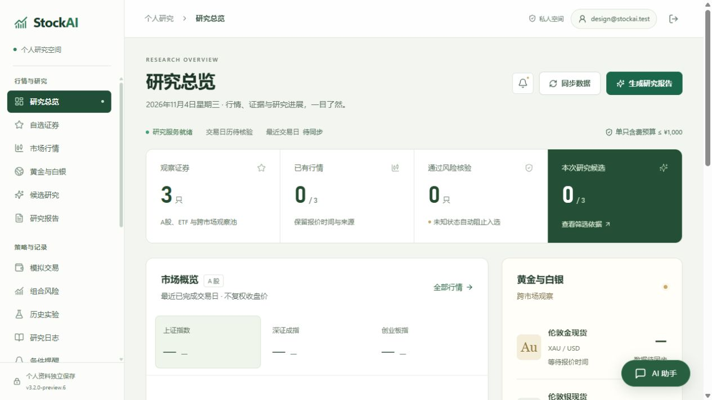
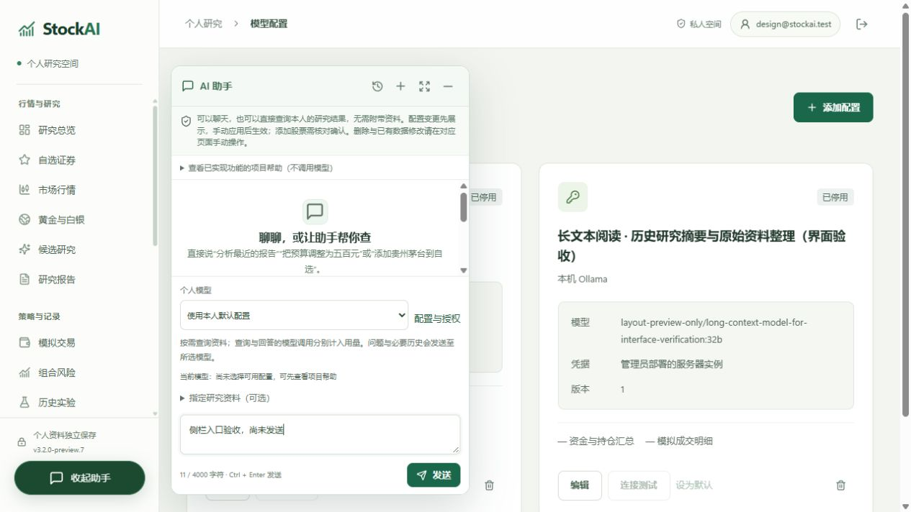
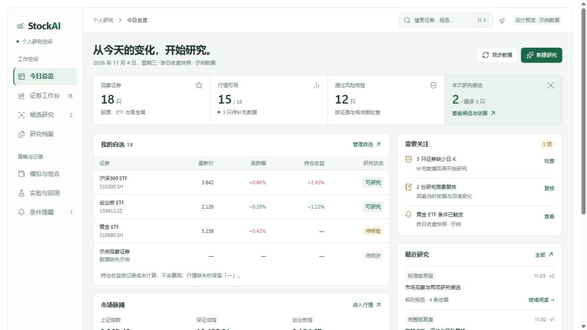
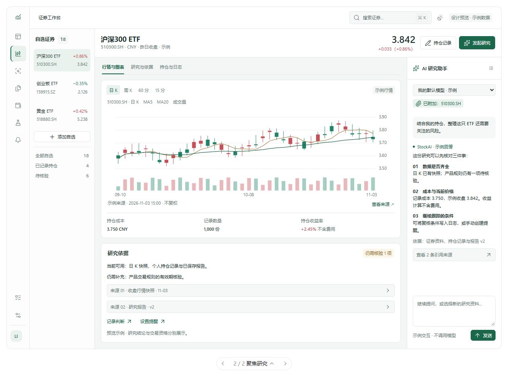
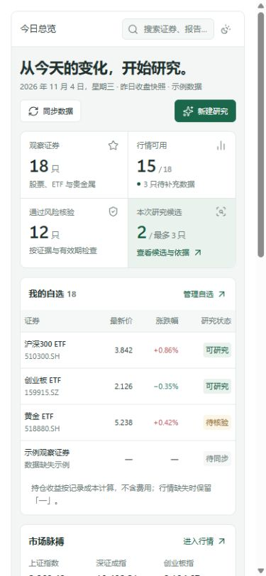

# StockAI 界面改版方案：清晰总览 + 聚焦研究

日期：2026-11-04。状态：供确认的设计方案。

建议保留 StockAI 已有的绿色识别、研究和模拟能力，借鉴 Trail 的安静工作区、紧凑信息层级与图表/助手并排布局。首页回答「今天先看什么」，证券页支持「围绕同一标的连续研究」。

本轮交付方案与独立预览，没有修改业务前端、后台、个人数据、版本号或发行包。预览中的行情、持仓、数量、任务和助手回答全部是明确标注的合成示例，不能作为实际行情或投资判断。

## 1. 已了解的项目现状

本方案依据当前源码、3.2.0—3.2.2 更新记录、近期 UI 修复记录及项目内验收图片整理；没有以旧版 README 首页图替代现状，也没有读取正式个人数据库。

### 已有优化应继续保留

- 桌面与 Web 共用导航；任务、实验和配置已有唯一入口。
- 浅色、深色、跟随系统，六种强调色及自定义色；行情可选择红涨绿跌或绿涨红跌。
- 手机筛选与表单布局、长模型名称换行、研究卡片和空状态已经过整理。
- 助手入口已移至桌面侧栏，手机使用紧凑入口；悬浮与独立页面共用会话、草稿、引用和进行中的请求。
- 自选可以记录持仓价、数量与按已存日 K 计算的收益；缺行情时保留缺失状态。
- 助手可查询已有研究并准备添加自选、持仓和配置方案，由用户手动应用。
- 同步、版本升级、本机账号与桌面凭据已有独立工作流。

### 这次要解决的问题

| 观察 | 对使用的影响 | 方案 |
| --- | --- | --- |
| 侧栏含 18 个常规入口，分为三组；较矮窗口需要滚动 | 常用研究与低频配置竞争位置 | 归为 9 个一级入口，细分内容放入页内标签；保留旧地址映射 |
| 标题、说明、状态行和大指标占据较多首屏空间 | 1280×720 下，自选和具体研究事项出现较晚 | 降低页头高度，指标改为紧凑信息带，自选上移 |
| 总览容易先看到系统状态，而不是下一步工作 | 不易判断先补数据、看报告还是继续研究 | 增加由现有记录派生的「需要关注」，每项直达处理位置 |
| 证券详情、报告、来源和助手之间存在切换 | 连续研究容易丢失当前对象 | 宽屏采用证券页、图表与助手并排；资料附加仍由用户明确操作 |
| 多份样式文件与兼容覆盖叠加 | 后续改主题、间距和断点的成本较高 | 实施时收敛现有变量与组件，逐步去除同一属性的重复覆盖 |

现状参考：

## 2. 参考 Trail 的哪些设计

已查看 Trail 官方工作台、今日概览截图与中文 UI 规范。截图展现了完整侧栏，文字规范还提出紧凑图标栏与上下文面板；方案按 StockAI 当前使用方式折中采用，避免直接照搬。

- 不透明的白色/深色表面、细边框、较小圆角，让视线集中在行情和依据上。
- 全局导航、当前证券、中央图表、可收起助手各有稳定位置。
- 报价、数据来源、时间和缺失状态靠近对应内容展示。
- 设置用两级组织，图标与文字保持克制，数值采用等宽数字。

参考来源：

- [Trail 项目与产品预览](https://github.com/ydflow/Trail)
- [Trail 工作台截图](https://github.com/ydflow/Trail/blob/main/docs/screenshots/ui-2026-10-16/workspace.png)
- [Trail 今日概览截图](https://github.com/ydflow/Trail/blob/main/docs/screenshots/ui-2026-10-16/today.png)
- [Trail 中文 UI 规范](https://github.com/ydflow/Trail/blob/main/docs/UI-SYSTEM.zh-CN.md)

预览没有使用 Trail 的 Logo 或图片素材。项目继续使用 Vue 3、ECharts 与 Lucide，不因设计改版迁移到 Trail 的技术栈。

## 3. 推荐组合：总览用清晰布局，证券页用聚焦布局

这两种布局分别服务于日常浏览和连续研究，可在同一产品中组合使用。预览允许比较两种外壳；推荐先采用清晰总览，再把聚焦布局用于证券研究页。

### 清晰总览

优先级从上到下：

1. 紧凑页头：日期、数据口径，以及「同步数据」「新建研究」两个动作。
2. 四项研究指标：观察证券、行情可用、通过风险核验、本次研究候选。候选仍保持最多三只，也可以为零。
3. 主要区域先展示自选与持仓收益；次列展示需要关注和最近研究。
4. 市场脉搏、贵金属等跨市场信息作为补充，来源时间贴近数值。

「需要关注」只使用项目已有的数据：数据就绪缺口、已设复核日期、已触发提醒、部分失败任务。不能从缺失记录推断为零，也不添加没有依据的「AI 推荐分」或「胜率」。若某类记录当前无法直接取得，第一阶段使用现有页面链接，不先扩建后台。

### 聚焦研究

- 左侧为紧凑全局导航；宽度足够时显示自选清单，窄一些时收起为证券选择入口。
- 中间顶部固定当前证券身份、币种、价格口径与持仓入口，下方展示图表。
- 图表下方放研究依据、核验缺口、判断日志与提醒入口。
- 右侧为可收起 AI 助手，顶部显示模型和已附加的资料，输入区保持易于找到。
- 助手与独立页面继续使用同一个实例，不因开关面板重复请求或丢失草稿。
- 切换证券时更新页面上下文，但不自动替换已附加的报告、版本和资料；明确显示附加内容，并提供「使用当前证券」动作。

页面中的「研究与依据」「持仓与日志」以现有证券资料、报告、持仓与日志功能为基础；当前项目未提供的财报或新闻字段不放入第一阶段承诺。

## 4. 导航整理

| 新一级入口 | 收纳现有内容 | 迁移要求 |
| --- | --- | --- |
| 今日总览 | 研究总览 | 继续兼容 `dashboard` |
| 证券工作台 | 自选证券、市场行情、黄金与白银、证券详情 | 列表、分组、置顶、筛选、持仓编辑和来源入口保留 |
| 候选研究 | 候选与筛选依据 | 保留预算、交易资格和证据核验口径 |
| 研究档案 | 研究报告、研究日志、周度复盘 | 页内分标签；保留归档版本和原链接 |
| 模拟与组合 | 模拟交易、组合风险 | 明确标注模拟账户，个人持仓记录单独标识来源 |
| 实验与回测 | 历史实验、历史回测档案 | 保留参数、区间、基准和历史记录 |
| 条件提醒 | 提醒条件与触发记录 | 保留现有条件类型和通知行为 |
| 任务中心 | 执行队列、日志、自动研究计划 | 保留部分完成、安全重试与任务结果跳转 |
| 设置 | 外观与研究偏好、模型与用量、数据与来源、同步与版本 | 预算、费用、授权、备份等原配置仍可找到 |

账号与数据放在个人入口；站点管理仅向原本具备权限的用户显示。AI 助手入口保留在侧栏底部与研究页工具栏，不再加入一套重复主导航。数据就绪度仍可从状态入口或「设置 → 数据与来源」进入。

## 5. 视觉与交互规格

| 项目 | 建议 |
| --- | --- |
| 基础色 | 浅色画布 `#F4F6F6`、内容面板 `#FFFFFF`、主文字 `#20312E`、次级文字 `#687875`、边框 `#E3E9E6` |
| 品牌色 | 沿用当前森林绿 `#1B674C`；其他预设和自定义强调色继续可用 |
| 深色 | 使用已有主题机制，统一映射画布、面板、文字、边框与图表；避免逐页补丁 |
| 行情与状态 | 涨跌色沿用个人偏好；数据风险/失败/成功使用独立语义颜色，并附文字 |
| 字体 | 继续使用 Windows/中文系统字体；正文 13–14px，辅助文字 11–12px，页标题 24–28px |
| 数值 | 价格、涨跌、持仓收益使用 tabular numbers，精度、币种和单位依资产类型显示 |
| 间距与形状 | 按 4/8px 递进；内容间距约 16–24px；按钮圆角 6–8px，面板 10–12px，1px 边框 |
| 数据表 | 默认行高 48–56px；筛选与操作靠近表格；长名称自然换行或可展开 |
| 动作 | 每个区域一个主操作；编辑、导出、来源等次级操作用中性按钮或文字入口 |
| 反馈 | 请求中、成功、空、失败、部分完成分别呈现；没有行情时使用「—」，不补造曲线 |

主题色不能影响行情涨跌习惯。自定义色继续沿用当前前景对比度计算；实现时检查浅色、深色及所有预设，不只验收森林绿。

[查看深色证券工作台效果图](trail-inspired-2026-11-04/workbench-dark.jpg)。

## 6. 手机与较窄窗口

- 宽屏：可展开导航、证券清单、主内容与助手；研究内容优先获得空间。
- 中等宽度：先收起自选次级清单，再按可用宽度改为可收起助手；避免强行保留四列。
- 手机：内容单列，底部「总览 / 自选 / 研究 / 组合 / 更多」，低频入口归入「更多」。
- 手机表格先显示名称、现价、涨跌和研究状态；点击证券后查看持仓成本、数量和收益等完整字段。
- 正式实现的底栏需要安全区占位；不遮挡输入和页面末尾动作。预览以普通流内底栏展示结构。
- 助手在手机上作为独立层或独立页面，保留现有键盘避让、草稿、焦点与停止生成逻辑。
- 点按区域至少约 44px；不依赖 hover 才出现关键操作。

## 7. 实施顺序

| 阶段 | 范围 | 完成后可审阅的结果 |
| --- | --- | --- |
| 第一阶段：统一外观与总览 | 共用颜色/间距/组件、导航折叠、紧凑页头、自选上移、总览两列、深浅主题 | 使用现有 API 的首页与导航，可单独验收 |
| 第二阶段：连续研究 | 证券页图表、依据和助手并排，持仓入口、引用与报告版本联动 | 从自选进入证券、查依据、向助手提问的完整流程 |
| 第三阶段：整理低频页面 | 设置分组、研究档案标签、任务日志与研究计划、手机底部导航 | 旧入口可达，编辑与任务行为无回退 |

第一阶段优先体现视觉和实用性提升；功能合并按入口组织开展，保留底层数据和旧页面地址，避免一次性重写大型页面。

拟涉及的现有文件：`workspaceNavigation.ts`、`WorkspaceNav.vue`、`navigation.css`、`workspace.css`、`appearance.css`、`PublicApp.vue`、`App.vue`、`AssistantDock.vue`、`ResearchWorkbench.vue`。正式实现时先提取共享壳层、基础控件与语义变量，再逐页接入，减少重复覆盖。

## 8. 验收边界

正式实施时检查：

- 1280×720、1440×900、1024×768，以及 390px/320px 窄屏；横向溢出、按钮裁切、弹层层级与键盘焦点。
- 浅色、深色、跟随系统；六个预设色、自定义色、两种行情涨跌色。
- 有数据、首次使用、数据缺失、加载、失败与部分完成；没有真实数据时不使用预览示例填充。
- 自选分组/置顶、持仓与收益口径、报告版本、提醒、任务安全重试、同步与升级入口均可用。
- 助手开关/换页/独立页/停止/退出，草稿与引用版本连续，不因布局变化重复调用模型。
- 模型与账号权限保持原范围；站点管理仍仅向原有管理员提供。

本轮只验证独立设计预览。预览中的部分次级页面为说明布局的简化场景，不是生产功能验收，也不包含正式 API 或模型调用。

独立预览已完成的检查：

| 检查 | 本轮结果 |
| --- | --- |
| 桌面、1024px、390px、320px 视口 | 已检查；最终页面及重点容器未发现横向溢出。预览宿主带外边距，320px 视口下内部可用宽度约 273px |
| 浅色与深色 | 已核对页面、文字、表格、图表与助手的颜色切换 |
| 主要演示交互 | 布局切换、证券切换、持仓示例、来源查看、任务提示与助手收起后草稿保留可操作 |
| 脚本语法与浏览器控制台 | 语法检查通过，最终预览控制台无 error 记录 |
| 效果图 | 已保存桌面首页首屏、证券工作台、深色工作台与手机首页首屏 |

具体尺寸与检查记录见 [preview-checks.json](trail-inspired-2026-11-04/preview-checks.json)。视口模拟不等同于手机真机验收。

## 9. 本轮交付

- 可在对话内切换的「清晰总览」「聚焦研究」两种布局。
- 桌面总览、证券页、手机页与深色页的本地效果图。
- 本方案文档和预览检查记录。

建议确认视觉方向后，先实现第一阶段，再接入证券页和助手的连续研究布局。
