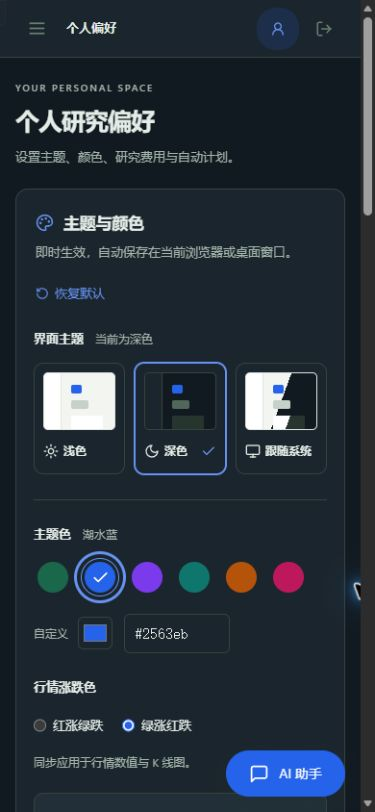
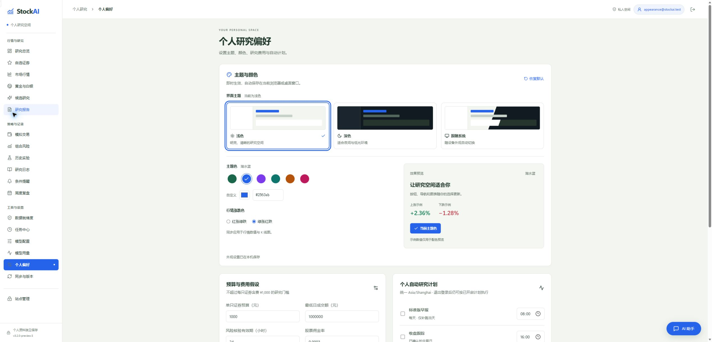

# 主题与颜色设置

桌面版和独立 Web 站点在「个人偏好 → 主题与颜色」配置；原源码本地版在「系统设置」配置。

- **界面主题**：浅色、深色、跟随系统。默认跟随系统，设备外观变化时自动切换。
- **主题色**：森林绿、湖水蓝、鸢尾紫、青碧、琥珀、玫瑰，也可以使用取色器或输入 `#RRGGBB` 自定义颜色。文字与按钮会调整前景色以保持可读。
- **行情涨跌色**：红涨绿跌或绿涨红跌，同时应用于行情数值和 K 线图。风险提示和操作状态保留各自含义。
- **恢复默认**：恢复跟随系统、森林绿和红涨绿跌。

外观选择即时生效并自动保存在当前浏览器或桌面窗口，刷新后恢复；同源窗口会同步更新。不同浏览器、设备和站点地址分别保存。浏览器禁止本机存储时，仍能修改本次外观，页面会提示无法保存。

外观设置独立于预算、费用和研究计划，无需点击「保存个人偏好」。

## 开发验证

```powershell
node --test tests/frontend-*.test.mjs
npm.cmd --prefix frontend run build
npm.cmd --prefix frontend run build:public
```

外观测试覆盖设置恢复、系统主题响应、异常存储、窗口同步、恢复默认、自定义颜色对比度，以及 K 线、提示框和权益曲线配色。界面使用隔离的测试账号验证，包含桌面与 390 像素窄屏布局。




