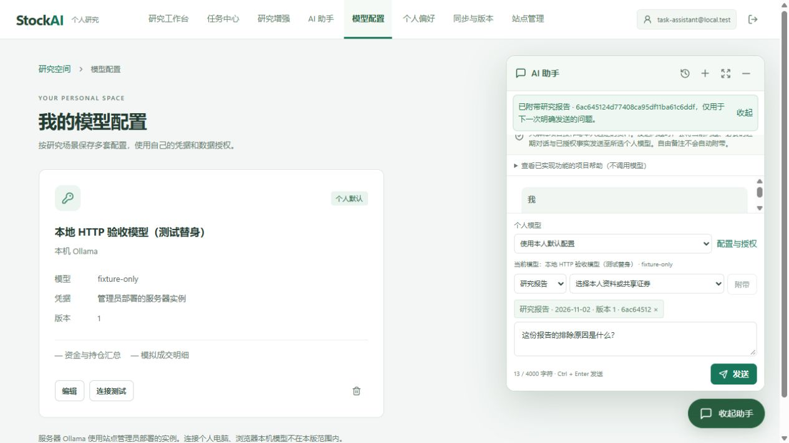
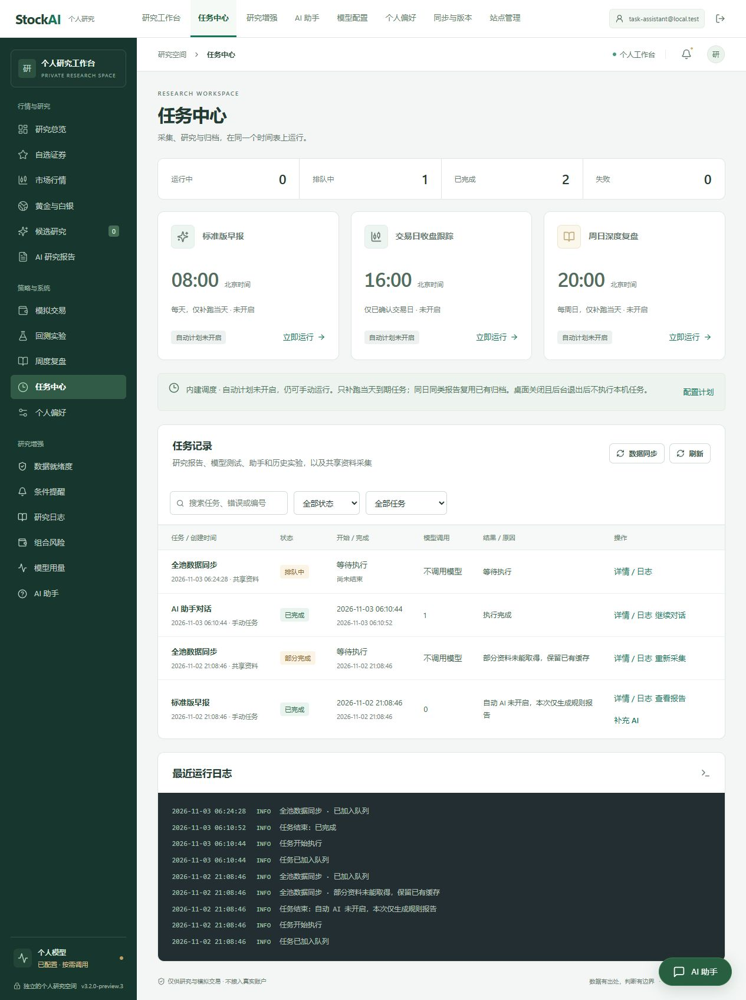

# 任务中心与全局 AI 助手修复记录

日期：2026-11-03（Asia/Shanghai）。版本：`3.2.0-preview.3`。面向单文件 Windows 桌面及共用的 Web 界面。

## 已修复

- 任务中心在顶部全局导航可直接进入，研究增强侧栏也提供入口。核心侧栏在较矮窗口内独立滚动，任务入口不再只能依赖滚到旧菜单底部。
- 任务中心集中展示研究报告、补充 AI、模型连接测试、助手对话和历史实验；站点管理员同时查看共享资料任务。提供状态、范围和关键词筛选、执行时间、模型调用次数、结果跳转、逐项详情及日志。
- 安全重试创建新记录，原任务及报告保留，重复点击复用同一重试任务。报告补充 AI 使用原事实并生成新版本；过期任务不补造历史，不确定发送不直接重发。
- 共享采集保留原始结果字段和采集参数，`partial` / `unavailable` 不再被统一记为成功。失败与部分完成的任务可按原证券和周期重新采集。
- 已登录业务页面右下角提供 AI 助手，顶部保留独立助手页面。两种入口使用一个持续挂载的会话实例，共享草稿、模型、所选资料、阅读位置及请求状态；收起和切页不会发送、取消或重建请求。
- 报告等业务入口显式附带资料，显示报告日期与版本，不因切页自动替换。可查看历史、新建会话、停止生成、查看引用，并按会话地址刷新恢复。
- 业务确认弹窗优先，支持 Escape 收起、焦点返回入口、Enter 打开并恢复草稿。窄屏面板预留顶部导航、滚动条和安全区；可用高度减小时保留模型/资料摘要和输入操作。
- 退出登录移除助手与草稿。API 拒绝上一身份的迟到响应，旧请求的 401 不会把新登录身份退出。帮助库更新为 `research-workbench/2`，增加任务中心操作和双入口说明。

## 使用

打开 `dist/StockAI-3.2.0-preview.3-Windows.exe`。顶部「任务中心」查看任务及日志；右下角「AI 助手」可在当前页面提问，面板右上角展开按钮进入同一会话的独立页面。收起保留草稿；「停止生成」才会请求停止。

从报告详情选择「就此报告提问」只附带该归档版本，不自动发送问题。确认模型与资料后点击发送。短视口可在面板顶部展开到独立页选择模型和资料。

## 验证范围

使用项目 `.tmp/task-assistant-preview` 内的合成账号、规则报告及本机 HTTP 模型替身；没有读取正式个人数据库或调用用户模型。模型替身延迟回答，用于观察生成时切页和收起。

已实际验证：总览、任务中心、报告和模型配置页的入口与草稿连续性；独立页刷新恢复；生成提示与原会话任务跳转；报告版本附带；确认遮罩、键盘和焦点；退出后私密界面清理；共享采集重试去重、筛选及日志。

一个问题在切页、收起、独立页与刷新后仍只有一次 HTTP 模型调用，原会话 `f4099201a16b4d149b41ec4c2fac1cd0`、任务 `4507cc17c24b413f98d4ce535f267f84`。这些标识仅属于合成验收数据。

视口验证覆盖默认桌面、360×780 和缩小至 360×520 的可用高度；窄屏面板左缘 8px、右缘 337px，没有水平溢出，缩小高度后的发送操作下缘约 436px，位于 520px 视口内。真实手机软键盘、特定系统底栏仍需目标设备验收，不能把视口模拟当作真机结论。

最终测试汇总与产物校验见 [本次发布记录](RELEASE-3.2.0-preview.3.md)。本目录图像及分组测试保留开发过程证据，最终发行验证以冻结源码后的完整回归和真实 EXE 检查为准。

## 图像证据

窄屏及缩小高度证据：`assistant-mobile.jpg`、`assistant-short-viewport.jpg`。双入口逐项状态见 [验收清单](验收清单-AI助手双入口.md)。

## 构建隔离

验收期间，其他任务持续更新同步、升级及相关测试。最终发行改为使用 `2026-11-03T09:18:11+08:00` 捕获的独立源码快照（`.tmp/task-assistant-release-20261103`），先逐文件验证复制前后摘要一致，再在快照内完整回归、打包和自检。实时工作区的后续修改保留，不自动进入本发行包；构建输入摘要及快照清单随 `verification.json` 保存。没有通过回退其他任务的修改来固定构建。
