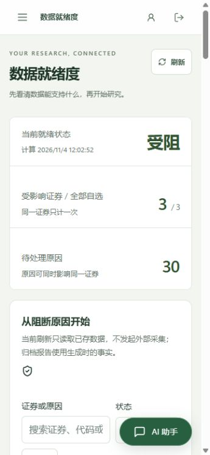
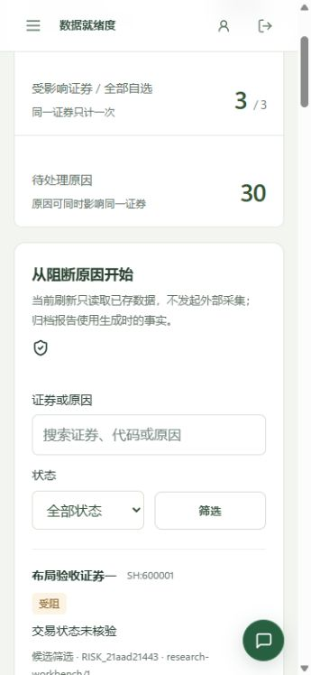
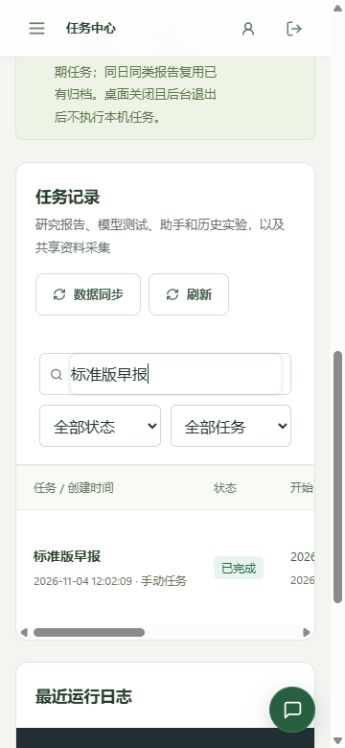
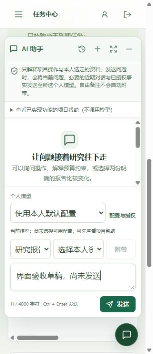

# 手机筛选与助手入口整理

2026-11-04，`3.2.0-preview.6` 本地预览。延续上一轮视觉风格，处理窄屏控件拥挤及悬浮入口遮挡内容的问题。

- 研究就绪度、条件提醒和研究日志的手机筛选栏使用两列网格；搜索输入独占一行，状态和筛选操作在下方对齐。
- 任务中心搜索框独占一行，任务状态和范围选项平分下一行；手机筛选和导出控件的触控高度统一为至少 44px。
- 手机 AI 助手入口改为 48×48px 圆形图标按钮，保留原有可访问名称、生成和未读提示。展开、收起与草稿保留继续使用原有行为；桌面入口保留文字。

## 验证

使用独立测试目录、合成账号与证券，关闭后台外部采集，不发送真实模型请求。

| 检查 | 结果 |
| --- | --- |
| 固定源码前端回归 | 18 项通过 |
| `npm run build:public` | 固定副本构建通过 |
| 360px 研究搜索框 | 宽度从 152px 增至 271px |
| 实际研究筛选 | 搜索“布局验收证券二”返回该证券的 10 条原因 |
| 360px 任务筛选 | 搜索框 263px，状态和范围各 126.5px，高度均为 44px；搜索保留对应早报记录 |
| 320px 手机 | 表格在容器内横向滚动，页面没有横向溢出 |
| 助手入口与对话 | 入口 48×48px；320px 下展开、收起后未发送草稿仍保留 |
| 1024px / 1280px | 页面无横向溢出，桌面助手入口保留文字和 124px 宽度 |
| EXE 离线自检 | 双客户端、静态页面、采集子进程与助手连续追问通过 |
| EXE 资源核对 | 19 个内嵌资源与最终固定构建的 SHA256 一致 |

布局尺寸和操作结果见 [验收数据](evidence/ui-detail-2026-11-04/layout-verification.json)。视口模拟不等于手机真机验收。

## 构建来源

最终源码固定在 `.tmp/ui-detail-3/release`，基于已提交的 `e73eff8` 并叠加本轮样式与版本。共享工作区其他未提交功能保持独立。打包使用固定资源，最终入口为 `dist/StockAI-3.2.0-preview.6-Windows.exe`。

产物大小 286,597,486 字节。摘要与来源见 [二进制核验](evidence/ui-detail-2026-11-04/binary-verification.json)，实际运行结果见 [离线自检](evidence/ui-detail-2026-11-04/self-test.json)。

最终产物复制核验后，清理旧验收副本、重复 EXE 和打包工作目录，释放 606,053,560 字节（约 578 MiB）；移除三处临时依赖链接，实际依赖、固定源码和已有发行版保留。见 [清理记录](evidence/ui-detail-2026-11-04/build-cleanup.json)。
