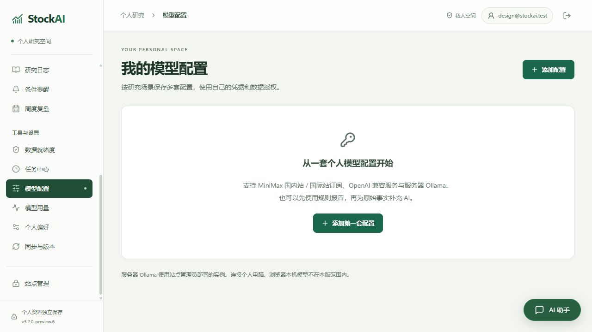
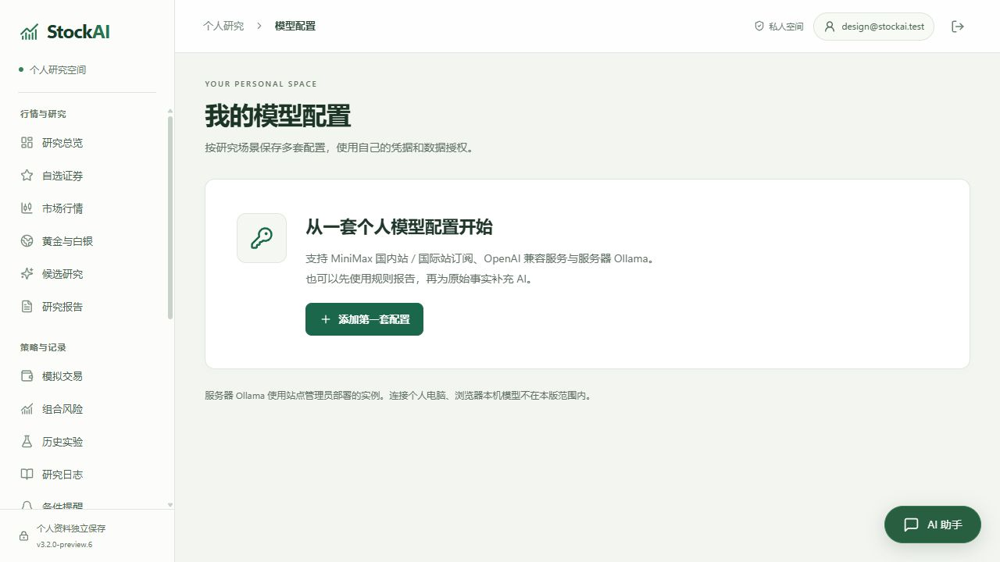
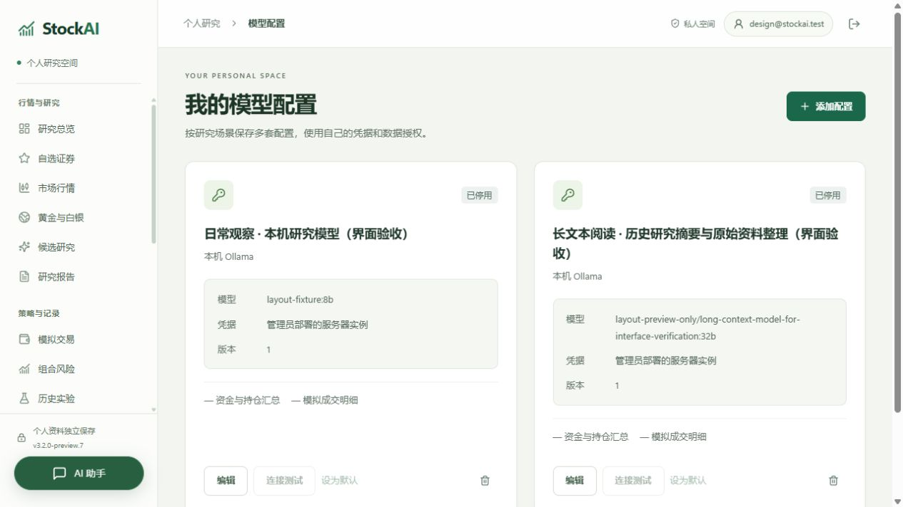
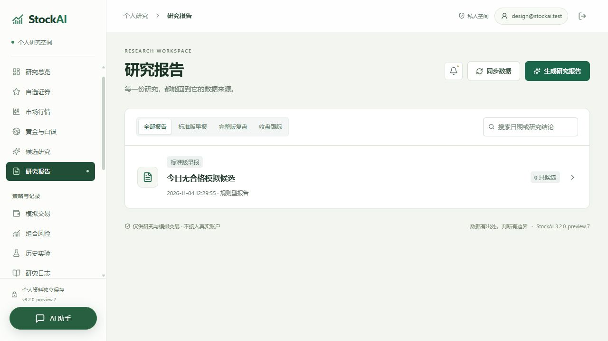

# 空状态、研究卡片与桌面助手

2026-11-04，`3.2.0-preview.7` 本地预览。延续现有配色与导航，整理桌面内容区，并处理助手入口遮挡卡片操作的问题。

- 模型、候选、模拟账户等带图标的空状态使用紧凑的图标与说明布局，手机端改为单列。
- 空模型页保留一个添加入口；已有配置时，页头继续提供添加操作。
- 模型卡片将参数放入独立区域，长名称与模型标识自然换行，底部操作对齐。
- 报告列表统一图标、标题、时间与状态的层级，并调整手机排版。
- 桌面助手入口移至侧栏底部，对话面板在侧栏旁展开；手机保留 48px 紧凑入口。

## 验证

| 检查 | 结果 |
| --- | --- |
| 固定源码前端回归 | 35 项通过 |
| 前端构建 | `npm run build:public` 通过 |
| 空模型页 | 高度约 332.5px → 244px；添加入口由两个合并为一个，能正常打开、取消表单 |
| 已有模型配置 | 页头添加操作恢复；1280px、1024px 下不同长度卡片的操作区对齐，参数无横向溢出 |
| 报告列表 | 桌面和 360px 手机可读；报告能正常打开并返回列表 |
| 桌面助手 | 1280px 入口位于 x=20–204，内容区从 x=224 开始；1024px 下也完全位于内容区之外 |
| 助手面板 | 桌面面板位于 x=240–660，展开、收起后未发送草稿保留 |
| 手机助手 | 入口保持 48×48px，面板在 360px 视口内，草稿在切换屏幕宽度后保留 |
| 最终 EXE | 离线自检通过，19 个内嵌页面资源与固定构建的 SHA256 一致 |
| 浏览器控制台 | 最终验收标签页无 error 记录 |

验收使用隔离账号、合成证券与停用的示例模型配置，不连接真实模型或采集真实行情。具体布局数据见 [验收记录](evidence/ui-cards-2026-11-04/layout-verification.json)。视口模拟不等于手机真机验收。

空状态结构调整前后（版本号更新前的样式验收截图）：

最终卡片与侧栏助手：

## 构建来源

使用 `.tmp/ui-cards-4/release` 固定源码，基于 `080740c` 叠加本轮样式、版本和空模型页按钮条件。共享文件 `PublicApp.vue` 只纳入本轮条件调整，其他并行修改保持独立。

桌面入口为 `dist/StockAI-3.2.0-preview.7-Windows.exe`。最终摘要和来源见 [二进制核验](evidence/ui-cards-2026-11-04/binary-verification.json)，实际运行检查见 [离线自检](evidence/ui-cards-2026-11-04/self-test.json)。

最终产物为 286,627,874 字节。核验后清理旧验收源码、重复 EXE、中间打包目录和被替换的本地草稿，释放 893,476,109 字节（约 852 MiB）。三处临时依赖链接已移除，实际依赖、固定源码及原发行文件保留。见 [清理记录](evidence/ui-cards-2026-11-04/build-cleanup.json)。
