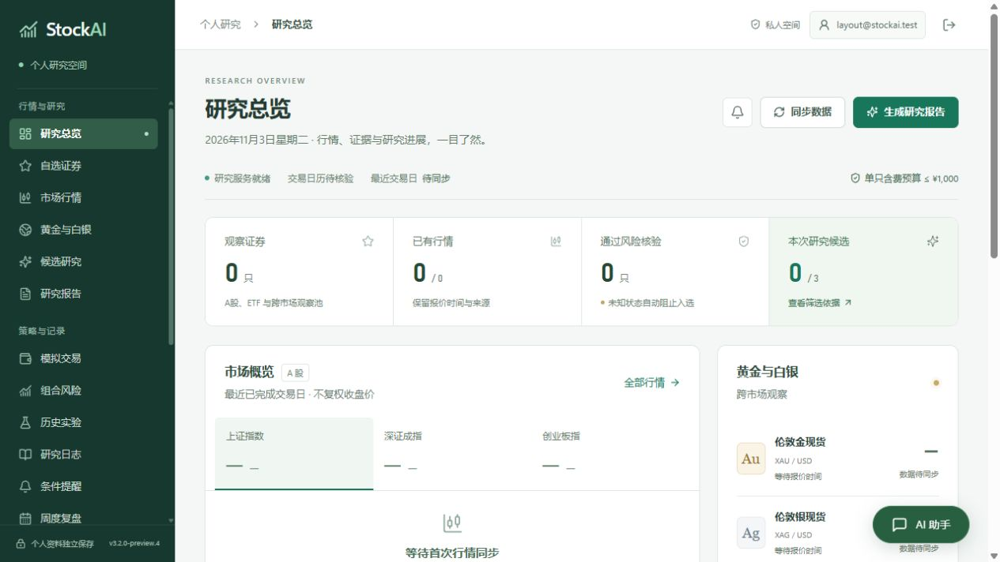
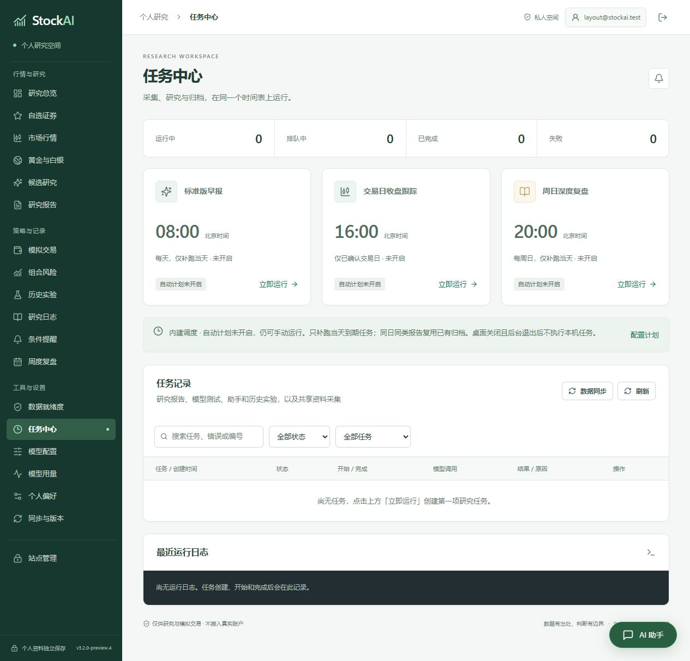
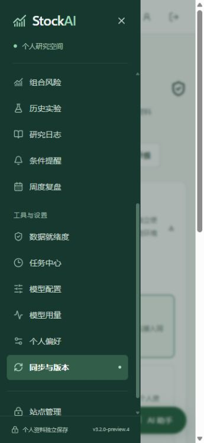
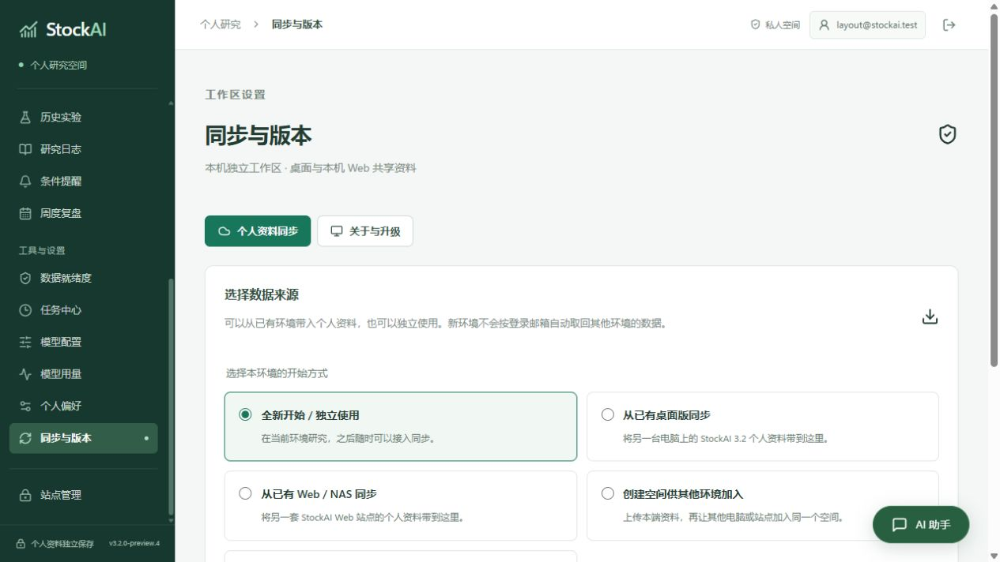

# 页面整理与构建历史清理

2026-11-03，`3.2.0-preview.4` 本地预览。此次提交包含页面整理与构建清理记录；登录与局域网等独立改动单独保留。源码按用户要求提交、推送，分发版本仍为本地预览。

## 页面调整

- 由 `PublicApp` 持续挂载统一侧栏，按“行情与研究 / 策略与记录 / 工具与设置”组织入口；核心工作台、研究增强页、模型与同步设置使用同一导航。
- 顶栏只保留位置、账号和退出操作；移除嵌套工作台的重复侧栏及第二层顶栏。
- 侧栏统一使用“历史实验”，原有历史回测结果链接继续可读；站点管理的任务记录改为打开统一任务中心。
- AI 助手继续使用同一实例，悬浮与独立页切换保留草稿；独立页只保留一个“新建对话”操作。
- 统一内容宽度、标题、留白与指标带；同步设置改用实际存在的 `--border / --surface-soft / --dark` 变量。
- 手机导航改为抽屉，支持焦点限制、Esc 关闭、焦点返回及切回宽屏时自动关闭；表单和主要操作扩大触控区域。

## 验证

| 检查 | 结果 |
| --- | --- |
| 本次提交的隔离副本 | 15 项前端检查和 `npm run build:public` 通过 |
| `node --test tests/frontend-*.test.mjs` | 最终工作区 20 项通过（包含并行完成的认证回归） |
| 任务中心、桌面分发、数据来源初始化后端回归 | 39 项通过 |
| `npm run build:public` / `npm run build` | 两套构建通过 |
| 桌面、1024×768、360×780 布局 | 未发现页面横向溢出 |
| 工作台、历史实验、模型、研究日志、同步、助手页 | 统一主导航；不再挂载旧侧栏 |
| 助手草稿 | 切页、收起、展开到独立页后内容保留，未发送模型请求 |
| 手机导航 | 当前页获得焦点，Esc 返回菜单按钮，切回宽屏解除内容隔离 |
| 同步来源选项 | 实际边框为 1px，已选择状态有独立背景 |
| 真实 EXE 离线自检 | 双客户端、前端资源、采集子进程和助手连续对话通过 |
| EXE 内嵌页面 | 全部 19 个静态资源与固定快照逐项 SHA256 一致 |

后端回归在允许本机回环的环境中运行，使用独立临时目录。页面验收使用合成账号、空白研究资料和关闭后台网络任务的本机服务，不读取正式个人数据。视口模拟不代表手机真机验收。

## 构建清理

仅清理项目 `dist` 内旧发行包、重复 EXE，以及明确的旧打包目录、解包检查副本和 PyInstaller 中间产物。保留 `preview.3` 已发布产物及校验文件、`preview.4` 本地预览、当前发行源码快照、构建工具、依赖、运行目录和个人资料。没有改写 Git 历史。

删除前逐项解析绝对路径并核对工作区边界。旧 UI 构建副本含指向现有 `frontend/node_modules` 的 Junction，先仅移除链接本身，再递归删除构建副本；实际依赖目录保留。执行清单保存在 `.tmp/ui-polish-build-cleanup.json`。

实际清理 41 个目标、5,433,662,120 字节（5.06 GiB，约 5.43 GB）。逐项确认目标已移除，现用 Vue 依赖与 4 个保留产物均存在，保留产物的独立校验文件核对通过。完整清单见 [清理记录](evidence/ui-polish-2026-11-03/build-cleanup.json)。

## 图像

调整前参考：[上一版任务中心](evidence/task-assistant-2026-11-03/task-center-desktop.jpg)。该图使用上一轮合成数据，适合比较导航结构，不用于比较研究数值。

## 本地构建

桌面入口为 `dist/StockAI-3.2.0-preview.4-Windows.exe`。各产物以同名 SHA256、EXE 构建元数据及最终自检记录核对。新版本是本地预览，已发布的 `preview.3` 继续作为回退版本。

共享构建目录在打包期间被另一轮构建替换，最终改用 `.tmp/ui-polish-release` 固定源码和静态资源，复制前后摘要一致。EXE 以该快照为准，工作区后续独立改动继续保留。摘要见 [二进制验证](evidence/ui-polish-2026-11-03/binary-verification.json)，离线检查见 [自检结果](evidence/ui-polish-2026-11-03/self-test.json)。
