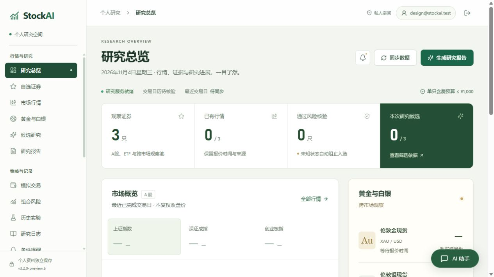
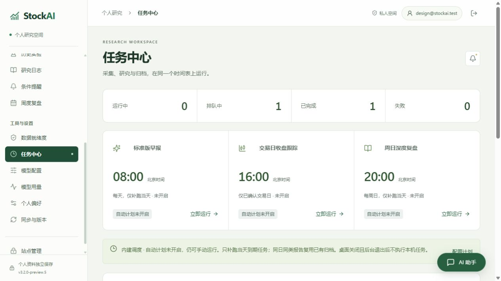
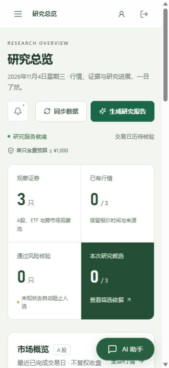
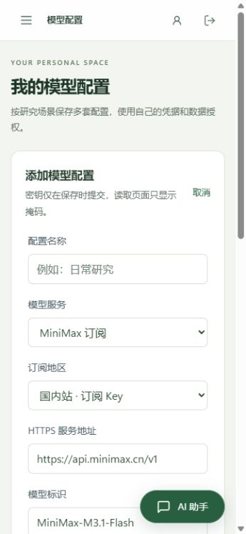

# 页面视觉优化第二轮

2026-11-04，`3.2.0-preview.5` 本地预览。本轮在统一导航基础上调整视觉层级，页面样式集中在 `frontend/src/navigation.css`，不改变研究、交易或同步流程。

## 调整

- 使用浅色侧栏、暖灰页面背景和更深的绿色主操作，统一标题、边框、按钮与表单。
- 总览指标采用连续区域，突出研究候选；指数选择、贵金属面板和空状态使用清楚的层级，不填入示例行情。
- 自动研究计划改为连续三栏，手机端按单列排列；任务通知按钮靠近标题，避免占用独立一行。
- 登录页延续同一配色，优化研究页、表格和个人配置的间距与文字对比。
- 修复手机模型和偏好表单中 `.span-two` 产生隐式第二列的问题。使用 `grid-column: 1 / -1`，单列和双列布局均填满实际网格。

## 验证

| 检查 | 结果 |
| --- | --- |
| 固定源码副本 | 基于 `8fcc574`，仅叠加本轮样式、版本和更新记录 |
| 前端回归 | 固定副本 18 项通过；共享工作区 23 项通过，后者含独立进行的认证改动 |
| 前端构建 | 固定副本 `npm run build:public` 通过，19 个静态资源摘要逐项一致 |
| 1280×720 / 1024×768 / 360×780 | 检查总览、任务和配置页面，未发现页面横向溢出 |
| 手机模型表单 | 单列宽 263px，8 个主要输入和选择框均为 263px，不再挤入窄列 |
| 导航与弹窗 | 保留一个主导航，根容器无 transform，手机导航与弹窗不被内容区域裁切 |
| 关键文字对比 | 8 处标题、指标说明与导航分组实测 4.61:1 至 12.07:1 |
| 浏览器控制台 | 验收标签页无 error 记录 |
| 真实 EXE 离线自检 | 双客户端、静态资源、采集子进程、助手问候与连续追问通过 |
| EXE 内嵌资源 | 全部 19 个文件与固定前端构建的 SHA256 一致 |

页面使用隔离测试空间和合成证券名称，后台网络任务关闭。未同步的行情显示缺失状态，未发送真实模型请求。视口模拟不等于手机真机验收。

具体布局尺寸和文字对比见 [验收记录](evidence/ui-refine-2026-11-04/layout-verification.json)。

## 页面效果

上一轮参考：[统一导航后的总览](evidence/ui-polish-2026-11-03/dashboard-desktop.png)。

## 本地构建

为避免共享构建目录被其他任务替换，使用 `.tmp/ui-refine-2-release` 固定源码和静态资源生成桌面预览。并行进行的未提交认证和升级改动未纳入此快照。本轮只提交自己的样式、版本、记录和验收证据。

本地桌面入口为 `dist/StockAI-3.2.0-preview.5-Windows.exe`，大小 286,592,539 字节。摘要和构建来源见 [二进制核验](evidence/ui-refine-2026-11-04/binary-verification.json)，运行结果见 [离线自检](evidence/ui-refine-2026-11-04/self-test.json)。没有发布 GitHub Release 或部署站点。

核验并复制最终产物后，移除本轮重复 EXE、PyInstaller 工作目录、过渡页面构建和两处临时依赖链接。实际释放 600,337,808 字节（约 572.5 MiB）；保留当前源码快照、真实依赖及已有发行版本。见 [清理记录](evidence/ui-refine-2026-11-04/build-cleanup.json)。
