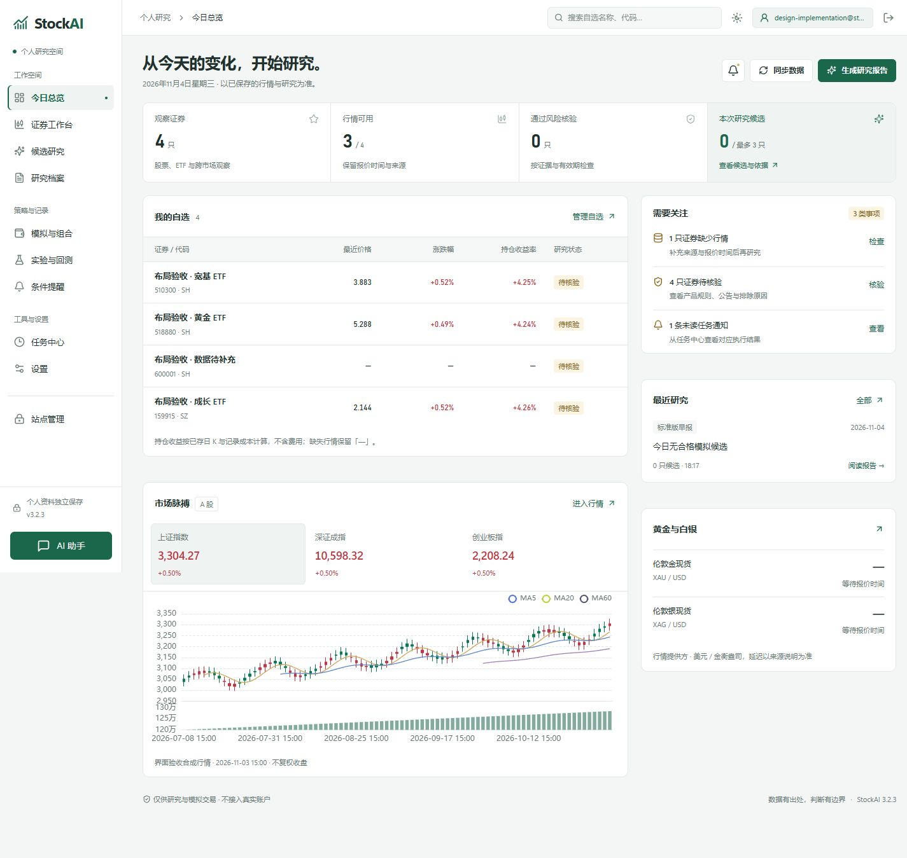
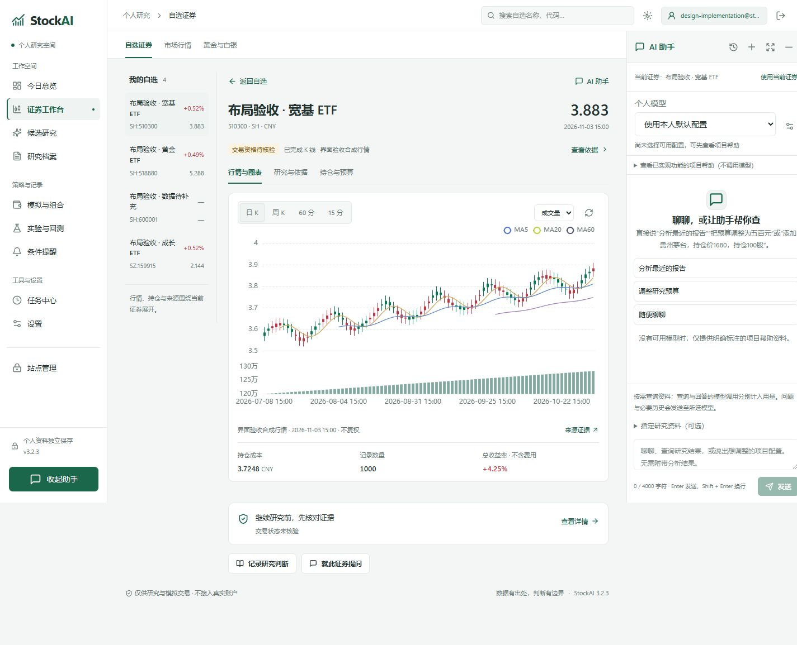
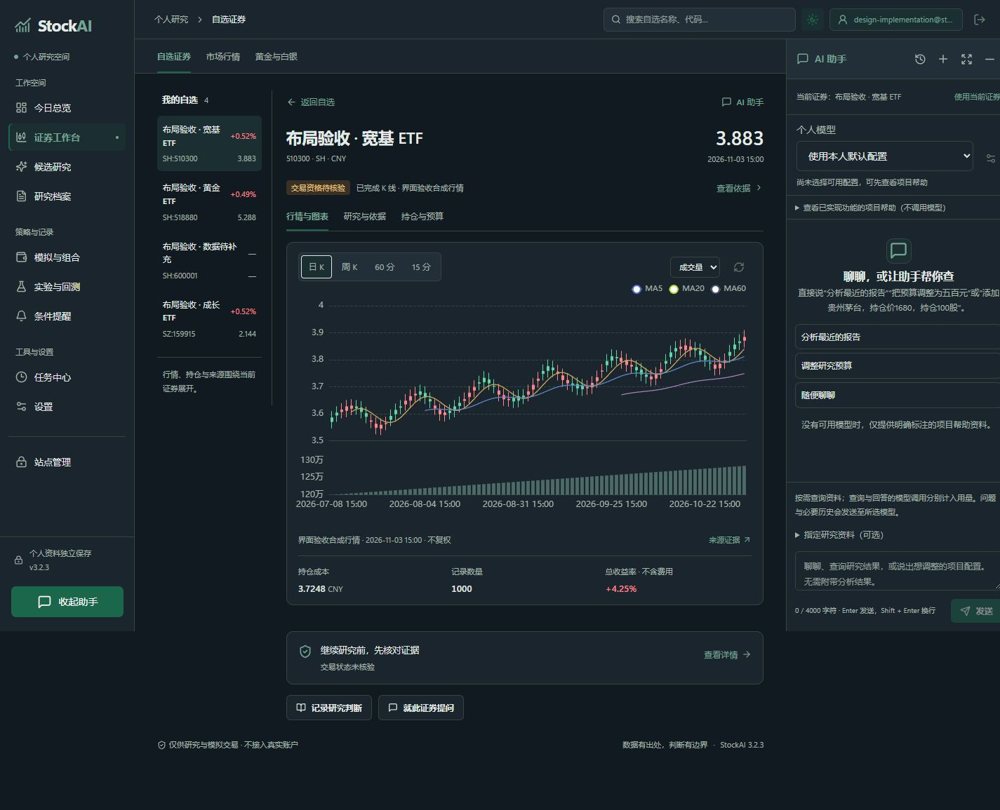
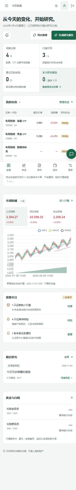

# Trail 风格工作台改版实施记录

日期：2026-11-04。按已确认的「清晰总览 + 聚焦研究」方案实施。

本次更新前端源码和本地/Web 两套构建。初次界面验收时尚未提交或重新打包；随后按用户要求进入 3.2.4 发布流程，包含工作区内已有的助手持仓输入修复。

## 已实现

- 常规一级导航从 18 项归为 9 项。证券、研究档案、模拟与组合、实验、设置通过页内子导航进入，原哈希地址继续可用；站点管理仍按原管理员权限显示。
- 总览采用紧凑页头和指标带，自选、持仓收益、数据缺口与最近报告优先展示。观察清单包含 ETF，不再只取 A 股普通股票。
- 数据缺口、待核验和任务通知来自当前 API；没有新增虚构的行情、推荐分或候选。零候选、行情缺失及无模型配置继续如实展示。
- 证券详情由侧边弹层改为完整研究工作区。宽屏显示自选清单、图表和右侧助手；较窄窗口使用证券选择框。分为「行情与图表 / 研究与依据 / 持仓与预算」。
- 原有 K 线周期、副图指标、来源证据、官方核验、公告同步、历史 JSON 导入和含费预算试算仍可用。持仓金额和收益仍读取后端结果，成本保留四位小数。
- 助手使用原有持续挂载实例。模型选择移至面板顶部，宽屏停靠时给内容区预留宽度；「使用当前证券」是显式附加动作，切换证券不自动替换已有报告版本或资料。
- 研究页自动展开助手只展示界面，不发送问题，也不抢占输入焦点。收起、切页、独立页往返继续保留草稿与引用。
- 新增手机底部常用导航；首页自选使用关键列，不再继承完整行情表的最小宽度。完整自选表保留全部字段和独立横向滚动。
- 调整浅色基础色、间距、圆角和文字层级；沿用现有深色、跟随系统、六种强调色、自定义色与涨跌色设置。
- 顶部搜索实际筛选本人自选；退出登录时清理搜索内容、当前证券与停靠状态。

## 验证

| 检查 | 结果 |
| --- | --- |
| `node --test tests/frontend-*.test.mjs` | 50 项通过，0 失败 |
| `npm --prefix frontend run build:public` | 通过 |
| `npm --prefix frontend run build` | 通过 |
| `git diff --check -- frontend/src tests/frontend-security-workspace.test.mjs` | 无补丁空白错误 |
| 快速切换证券、切换周期、返回列表后的迟到响应 | 新增四项请求顺序回归，旧响应不会覆盖当前证券或重新打开详情 |
| 旧地址与新导航分组 | 新增兼容性回归，行情、贵金属、日志、复盘、组合、历史回测和各设置地址仍可到达 |
| 1440×900 研究页 | 自选清单可见，右侧助手宽 320px，内容右边界与助手左边界相接，无覆盖或页面横向溢出 |
| 1280×720、1024×768 | 检查总览、搜索、任务及设置；没有页面横向溢出 |
| 390px / 320px 手机宽度 | 首页表格已完整收进内容宽度；320px 视口内表格与容器均约 275px，无内部溢出 |
| 390×520 短屏助手 | 面板 y=64–452，发送操作底部约 444px，处于可用区域内 |
| 编辑保护 | 模型配置有草稿时，底部导航触发原确认；取消后留在原页面并保留输入 |
| 助手草稿与引用 | 切换证券保留原附加证券；报告引用包含日期和版本；独立页往返保留草稿 |
| 退出登录 | 再次登录后顶部搜索为空 |
| 浏览器控制台 | 最终验收标签页无 error 记录 |

验收使用 `.tmp/trail-ui-implementation/workspace` 内的独立账号、合成证券和合成日 K。后台采集关闭，助手请求表为 0 条，没有调用真实模型或读取正式个人工作区。视口检查不等同于手机真机或软键盘验收。

详细 UI 结果见 [verification.json](evidence/trail-ui-2026-11-04/verification.json)。截图中的证券名、持仓和行情均为验收数据。

## 发布前复核

- 官方核验保存后强制重新读取证券详情，保留普通重复选择的去重行为。
- 预算响应只写回仍在查看的证券；切换证券后不会出现上一只证券的预算。
- 历史行情文件在读取前固定证券、周期和请求代次；读取期间切换证券会取消导入，避免把旧文件写到新证券。
- 新增四项回归后，前端共 54 项通过；本地与 Web 生产构建再次通过。初次 UI 截图与构建指纹保留为当时的验收记录，发布构建另行核对。

## 实际页面

## 主要实现位置

- `frontend/src/workspaceNavigation.ts`、`components/WorkspaceNav.vue`、`components/WorkspaceTabs.vue`：主导航、手机导航与旧地址分组。
- `components/ResearchOverview.vue`：总览、自选摘要、实际数据缺口与近期研究。
- `components/SecurityWorkbench.vue`、`App.vue`：证券工作区、请求顺序保护与原业务操作接入。
- `components/AssistantDock.vue`、`components/AssistantModelPicker.vue`、`ResearchWorkbench.vue`：右侧停靠、模型入口与同一会话连续性。
- `PublicApp.vue`：搜索、工作区状态、私有状态清理和子页面导航。
- `navigation.css`、`appearance.ts`、`appearance.css`：响应式布局与共用主题变量。

源码桌面入口和 Web 可使用这次构建。已安装 EXE 内嵌的是打包时的资源，需要后续重新打包才会采用新界面。
